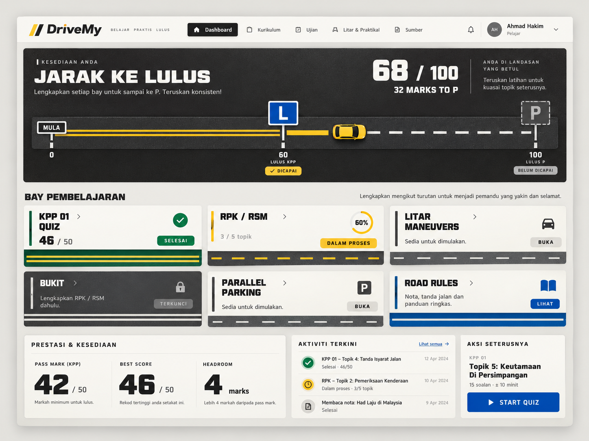

# DriveMy Dashboard | DESIGN.md

> **Design system:** Jalan  
> **Product:** DriveMy, Malaysian driving-learning platform  
> **Surface:** Authenticated learner dashboard (Operate mode)  
> **Reference render:** `drivemy_dashboard.png`, 1448 × 1086 px  
> **Status:** Visual specification of the generated product image, with guardrails from the supplied Jalan design system.



## 1. Concept

**The interface is the road surface. The content is the signage.**

The screen depicts a learner travelling from the beginning of training toward a P licence. Progress is not an abstract gauge: it is a **road** with lane markings, a car, and two licence checkpoints. Learning modules are **bays** along that journey.

- **Road / chrome:** restrained asphalt, concrete, paint, thin borders, and crisp geometry.
- **Signage / meaning:** real road-sign colors and status hues are the only saturated elements.
- **Tone:** operational, direct, competent, and distinctly Malaysian. Avoid gamification clutter or generic SaaS gradients.
- **Mode:** this is **Operate**, not a marketing landing page. Usability beats decoration.

## 2. Visual structure

### Reference composition

The generated visual is a wide desktop dashboard shown inside a softly shadowed application frame on a warm, light-gray presentation background. It is a **reference image**, not a pixel-perfect responsive wireframe. The placement estimates below describe its composition rather than immutable CSS coordinates.

| Region | Position and behavior | Key content |
|---|---|---|
| Application shell | Centered, generous outer margin, pale raised surface | Header plus stacked content |
| Header | Single full-width horizontal row | DriveMy, navigation, notifications, learner identity |
| Readiness carriageway | Dominant dark panel, full-width below header | `Jarak ke Lulus`, 68/100, 0 → L → P progress road |
| Learning bays | 3 columns × 2 rows at desktop width | Six curriculum cards with semantic road-rule bottoms |
| Information deck | 3 adjacent blocks, first noticeably wider | Performance, recent activity, next action |

Use a centered container around **1280–1320 px** at large desktop sizes, roughly **16–20 px** interior gutters, and **12–16 px** inter-panel spacing. The reference shows a desktop width of **1448 px**; these are implementation targets, not exact measurements of every edge.

### Reading order

1. Global navigation and identity.
2. Readiness score and licence road.
3. Learning modules and their availability.
4. Performance facts, recent activity, and next action.

The viewer should first notice **68/100**, then understand the road toward **P**, then see what can be continued.

## 3. Color tokens

Canonical Jalan colors from the supplied design specification:

| Token | Hex | Meaning / usage |
|---|---|---|
| `--asphalt` | `#23211E` | Dark carriageway and primary ink |
| `--concrete` | `#E4E3DE` | Page canvas, neutral surfaces |
| `--paint` | `#F7F5F0` | Markings, light plates and raised surfaces |
| `--awas` | `#F2B705` | In-progress / warning ONLY |
| `--berhenti` | `#C8102E` | Failure, blocked, below pass mark ONLY |
| `--lulus` | `#00703C` | Passed / completed ONLY |
| `--sign-info` | `#0057A8` | Information signs / licence plates |

A neutral ink/gray ramp (`--grade-1` through `--grade-9`) should derive from `--asphalt`, rather than neutral pure grays. The image adds subtle soft shadows to distinguish raised white cards from concrete. Those shadows must remain secondary to road markings.

### Color rules

- **Signal color carries information.** Yellow indicates progress, green success, red failure, blue informational signage.
- Never use these colors as random decorative borders or alternating card themes.
- Do not render red, yellow and green as adjacent status badges mimicking a traffic light.
- Yellow cannot serve as small text on white: use **dark ink on a yellow plate**.
- Active primary navigation is asphalt/dark, not a bright brand-color gradient.
- The hero road is visually dark, with white/yellow painted markings; content outside it is light and calm.

## 4. Typography

| Role | Typeface | Weight | Appearance |
|---|---|---|---|
| Display | **Archivo** (expanded width 112–118%) | 800 | Readiness headline, large scores, featured numeric figures |
| Body | **Barlow** | 400 / 500 / 600 | Navigation, labels, descriptions, data, buttons |
| Genuine road plate | **Barlow Condensed** | 600 / 700 | Uppercase lettering on L/P road signs and painted road labels |

### Suggested scale

| Usage | Desktop target |
|---|---|
| Hero title `Jarak ke Lulus` | 38–44 px, Archivo 800 |
| Hero score `68 / 100` | 54–68 px, Archivo 800, tabular numerals |
| Section headings | 19–22 px, Archivo 800 or Barlow 600 |
| Module titles | 20–24 px, Archivo 800 |
| Major data figures | 44–58 px, Archivo 800, tabular numerals |
| Body / controls | 14–16 px, Barlow 400–600 |
| Metadata / supporting labels | 12–13 px, Barlow 500 |
| Sign plates | Sized to the physical plate, Barlow Condensed uppercase |

**Important correction when implementing the image:** the AI render exaggerates all-capital headings and labels. The supplied Jalan rule is **sentence case for normal interface copy**. Reserve highly tracked condensed caps for actual road signage. This improves readability and avoids making the entire dashboard look like a road sign.

## 5. Geometry and surfaces

Jalan has intentionally hard road geometry:

| Component | Corner rule | Interpretation |
|---|---|---|
| Learning bay | **0 px** | Painted rectangular parking bay |
| Information plate / ordinary control | **4 px** | Slightly eased sign plate |
| Avatar, roundel, circular progress | **Circle** | Only genuinely circular components |
| Road markings | **0 px** | Crisp road paint |

Use these primitives:

- **`Carriageway`**: asphalt surface, internal on-road text palette, primary readiness visualization.
- **`Bay`**: learning module, rectangular, status kerb/edge, road-rule strip.
- **`Plate`**: informational panel, hairline border, maximum 4 px radius.
- **`RoadRule`**: semantic lane-marking component, not a generic divider.
- **`LPlate`**: licence checkpoint plate using proper blue / white sign language.
- **`Figure`**: large, concrete tabular numerals.

The illustration has more rounded outer cards than canonical Jalan. Favor the **0/4 px geometry** in the final implementation, even if that makes the coded UI a touch sharper than the image.

## 6. Road-marking semantics

Line style is functional information, not decoration.

| Name | Visual | State |
|---|---|---|
| `.mark-locked` | Double solid paint line | Prerequisite unmet |
| `.mark-closed` | Single solid paint line | Completed / closed |
| `.mark-open` | White broken line | Available to start or resume |
| `.mark-progress` | Yellow broken line | In progress |

Use `RoadRule` for horizontal or vertical road markings. Do not mix styles merely to make bays look different.

### Road visualization: `Jarak ke Lulus`

This is the product's signature component, shown as the image's top dark panel.

**Example reference state:**

```text
Readiness: 68 / 100
Remaining: 32 marks to P
Start: 0
L checkpoint: 60  | achieved
P checkpoint: 100 | not achieved
```

Structure:

- Upper left: small readiness label, title **Jarak ke Lulus**, one short supporting sentence.
- Upper right: oversize score `68 / 100`, label `32 marks to P`, and brief guidance.
- Bottom: a left-to-right carriageway from **0** to **100**, with a car positioned at the numeric score.
- **Behind the car:** earned progress, represented by a continuous painted section / paired solid road lines.
- **Ahead of the car:** open road, represented by dashed markings.
- **L checkpoint at 60:** square blue `L` licence plate, active only when the actual L gate is satisfied.
- **P checkpoint at 100:** dashed / muted plate until the actual P gate is satisfied.
- On narrow screens, retain the 0 / 60 / 100 logic and legibility rather than compressing labels until unreadable.

**Honesty rule:** a learner's position on the readiness road and whether they qualify for an L/P checkpoint are **distinct**. Do not infer licence achievement purely from the displayed composite score. Use the authoritative licence model (`src/lib/licence.ts` in the supplied codebase) for gate status.

The tiny yellow car is a helpful visual locator in the reference, but it must not obscure the road, numbers, or licence signage.

## 7. Navigation

The screenshot's top bar contains:

- **Logo:** `DriveMy` in bold dark lettering, with a small yellow/black road-stripe mark.
- **Navigation:** `Dashboard` (active), `Kurikulum`, `Ujian`, `Litar & Praktikal`, `Sumber`.
- **Utilities:** notification bell, learner avatar, learner name, small role label, account menu chevron.

Inactive navigation is quiet Barlow text with regular-weight icons. The current page uses a restrained asphalt-filled state with paint-white text. Avoid bright saturated color for the selected item unless the item itself is an authentic sign or state.

## 8. Learning bays

The image shows six cards, grouped as a 3-column desktop grid. Each card includes a title, one actionable affordance, compact supporting detail and an **edge/bottom road marking that encodes its state**.

| Bay | Example content from image | State | Treatment |
|---|---|---|---|
| **KPP 01 quiz** | `46 / 50`, `Selesai` | Done | Green check icon, completed state, closed road line |
| **RPK / RSM** | `3 / 5 topik`, `60%`, `Dalam proses` | Progress | Yellow progress ring/plate, yellow broken road line |
| **Litar maneuvers** | `Sedia untuk dimulakan`, `Buka` | Open | Neutral car icon, white broken line |
| **Bukit** | `Lengkapkan RPK / RSM dahulu`, `Terkunci` | Locked | Muted card, lock icon, double solid marking |
| **Parallel parking** | `Sedia untuk dimulakan`, `Buka` | Open | Neutral parking sign and broken line |
| **Road rules** | `Nota, tanda jalan dan panduan ringkas`, `Lihat` | Informational / open | Blue book/info symbol, clearly actionable |

Avoid bold green accent lines plus separate yellow lines on a completed card if the combination obscures what the status means. Status marking should communicate **one** unambiguous state.

### Bay interactions

- Entire unlocked bay can be a navigation target where appropriate.
- The card's CTA must identify an action (`Buka`, `Lihat`, `Sambung`, `Start quiz`), not a vague aspiration.
- Locked bays explain the actual prerequisite and do not look tappable.
- Hover adds restrained elevation or ink contrast; keyboard focus must be obvious.

## 9. Lower information deck

### Performance and readiness

A wide three-column summary of factual training metrics:

| Metric | Example |
|---|---|
| Pass mark (KPP) | `42 / 50` |
| Best score | `46 / 50` |
| Headroom | `4 marks` |

Use large Archivo figures and short explanatory captions. Headroom is explicitly the difference between the best score and pass mark; it is **not** a probabilistic exam prediction.

### Recent activity

A compact feed with small resolved-state icons, activity names, status/subtitles, and right-aligned dates. The screenshot shows illustrative dates from April 2024; replace these with actual recorded dates in a real product.

### Next action

The image's right-hand panel shows a next quiz suggestion, such as:

- Context: `KPP 01`
- Task: `Topik 5: Keutamaan di Persimpangan`
- Detail: `15 soalan · ± 10 minit`
- CTA: **Start quiz** with a filled play icon.

The reference uses a blue filled button. Under canonical Jalan, reserve sign-info blue for informational sign treatment. A neutral asphalt primary button is preferable unless there is a deliberate documented exception for the CTA.

## 10. Iconography

Use **`phosphor-react`** with only these weights:

- `regular`: default navigation and supporting icons.
- `fill`: completed/failed results and primary triggers such as `CheckCircle`, `XCircle`, `Play`, `Warning`.
- `bold`: small optical adjustments only, such as tiny checkmarks and 16 px arrows.

Custom litar/maneuver illustrations should look like **overhead painted paths** on a road, with purposeful curves and smooth path joins. Avoid random multi-color illustration packs, emojis as icons, and overly detailed skeuomorphic cars.

## 11. Responsive behavior

The image is desktop-only, so the following is implementation guidance rather than an observed mobile design.

| Viewport | Adaptation |
|---|---|
| ≥ 1200 px | Three learning columns; bottom data panels arranged horizontally |
| 768–1199 px | Two learning columns; performance can span full row; feed and next action below |
| < 768 px | One learning column; header collapses to compact menu; bottom panels stack |

For the readiness road on mobile, prefer an internally scrollable or specially reflowed road visualization with persistent 0/L/P anchors. Do not destroy checkpoint semantics to make everything fit one tiny row. Preserve appropriately sized tap targets and practical reading order.

## 12. Motion and accessibility

- **No staged page-load animations.** Learners arrive to complete a task.
- Animate the road **only when its actual numeric/state values change**.
- For motion, use `transform` and `opacity`; support `prefers-reduced-motion` fully.
- Maintain at least WCAG AA text contrast, including subdued metadata.
- Keyboard focus is a visible **painted yellow indicator**, not a barely visible soft ring.
- All icons need labels or nearby text conveying the same meaning.
- Do not rely on color alone: completed/in-progress/locked must also differ by line shape, icon, and words.
- Use actual text and HTML controls for any implementation; do not use the generated screenshot as a single-page interactive substitute.

## 13. Copy conventions

- Prefer **sentence case**: `Jarak ke Lulus`, `Bay pembelajaran`, `Aktiviti terkini`.
- Use authentic Malaysian learning vocabulary: `KPP`, `JPJ`, `RPK/RSM`, `litar`, `bukit`, `markah lulus`.
- Keep Bahasa Melayu and English capable of standing independently; don't make Malay an ornamental translation.
- Be concise and concrete: `32 marks to P`, `46/50`, `4 marks above pass mark`.
- Report failures factually without empty motivational filler.
- Label actions with verbs: `Start quiz`, `Sambung latihan`, `Lihat nota`.
- Do not treat readiness as a forecast of final exam performance.

## 14. Implementation mapping

The supplied Jalan source identifies these existing locations, which a code implementation can use rather than duplicating the design logic:

```text
src/index.css                             Design tokens / surface classes
tailwind.config.js                        Theme mapping
src/components/ui/road.tsx                RoadRule, Bay, Plate, Carriageway, LPlate, Figure, SectionHead
src/components/dashboard/ReadinessRoad.tsx  Main road progress component
src/lib/licence.ts                        Source of truth for qualification gates
docs/asset-generation.md                  Maneuver icon generation spec
```

A practical dashboard component hierarchy:

```text
DashboardPage
├── AppHeader
│   ├── DriveMyLogo
│   ├── PrimaryNavigation
│   └── LearnerMenu
├── ReadinessRoad
│   ├── ReadinessSummary
│   ├── RoadTrack
│   ├── LCheckpoint
│   └── PCheckpoint
├── LearningSection
│   └── LearningBay × 6
└── DashboardSummary
    ├── PerformanceMetrics
    ├── RecentActivity
    └── NextAction
```

## 15. Differences between the image and canonical Jalan

The generated image is a **concept render**, not a fully audited representation of the design rules. Fix these when building the production UI:

1. **Too much uppercase:** many interface headings/buttons use signage voice; the design system reserves it for real road signs.
2. **Too much rounding:** panel corners, badges and buttons are visibly rounder than the prescribed 0/4 px geometry.
3. **Potential color-semantic drift:** some blue/green/yellow borders and CTA fills read as accents instead of states.
4. **Road-marking inconsistencies:** confirm progress uses the documented yellow broken line and completed/open/locked markings use their exact meaning.
5. **Illustrative rather than sourced data:** 68/100, 46/50, 2024 activity dates, learner name and module completion shown in the image are mock content.
6. **No interaction or responsive proof:** the screenshot depicts one wide viewport and cannot establish how focus, motion, keyboard navigation, or mobile layouts work.

The strongest parts to retain are the **readiness carriageway**, **L/P licence checkpoints**, **road-marked learning bays**, and **clear numerically grounded next steps**.

---

**Design acceptance criteria:** An implementation should look unmistakably like a Malaysian driving-learning product, read quickly as an operational dashboard, reserve saturated colors for meaningful signage/status, keep checkpoint status truthful to the licence model, and follow the road-marking grammar consistently across modules.
