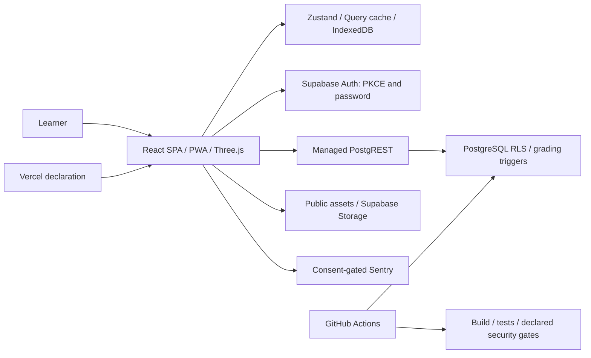

# DriveMy — Infrastructure and release-readiness audit

Date: 2026-10-07 (Asia/Kuala_Lumpur). Read-only assessment of current checkout. This replaces the historical TechStack report preserved at reports/TechStack.previous.md. All 15 sections and 140 checkboxes from docs/13-layer-audit.md are accounted for; reports/checklist-coverage.json verifies coverage. A source declaration proves only the declared control, never its deployed operation.

## Executive Summary

**NO-SHIP. Risk: 100/100 (higher is worse).** Across Phases 1–5, 36 distinct confirmed findings: 0 Critical, 9 High, 20 Medium, 7 Low. Weighted confirmed risk = 157; seven blocked/skipped security/testing areas add 35, then the requested 0–100 range caps the result at 100. Phase 6 adds no separate confirmed exploit finding; it records operational evidence gaps and cross-references existing roots.

The five most important **CRITICAL missing-evidence gaps** are below. CRITICAL here follows the supplied checklist's rule for missing evidence; it is not a claim of five demonstrated Critical vulnerabilities. Each detailed row records its own evidence, risk, action and priority. PARTIAL rows with missing operational proof also retain the CRITICAL gap flag.

| ID | File/Component | Category | What's wrong | Why it matters | Recommended fix | Severity | Confidence | Priority | Safe to auto-fix? | Found by |
|---|---|---|---|---|---|---|---|---|---|---|
| INF-001 | reports/phase-4-security.md; reports/phase-5-testing.md | Release validation evidence | Isolated database/Auth enforcement and complete browser journeys remain unverified; current advisory and dedicated scanner evidence is missing. | Static correctness and passing helper tests cannot establish the release's end-to-end safety. | Supply isolated staging/dummy accounts, restore a functioning browser and named scanners, resolve the credential egress gate, then run documented gates. | Critical (missing evidence; UNVERIFIED operation) | High that evidence is absent; not exploit confidence | P1 | N | Local attempts and coverage matrix |
| INF-002 | docs/DISASTER_RECOVERY.md:27-68,157-166 | Recovery evidence | A runbook exists, but current backup entitlement, recoverable data/assets and a completed restore drill are unverified. | A documented RTO/RPO can be impossible to meet when a real restore is needed. | Verify actual backup configuration and encrypted artifacts; restore schema, data, Auth and storage into disposable staging and record measured recovery. | Critical (missing evidence; UNVERIFIED operation) | High that evidence is absent | P1 | N | Runbook and missing drill record |
| INF-003 | vercel.json; supabase/config.toml; reports/phase-4-rls.md | Deployed security controls | Hosted auth settings, effective grants, headers/TLS, rate limits and origin-bypass resistance are unverified. | Repository policies do not prove production configuration or abuse resistance. | Export redacted settings/effective policies and validate the isolated equivalent; document deployment parity and control owners. | Critical (missing evidence; UNVERIFIED operation) | High that evidence is absent | P1 | N | Source/config comparison |
| INF-004 | src/lib/telemetry.ts; docs/DISASTER_RECOVERY.md | Detection and operations | Working alert delivery, synthetic monitoring, capacity limits, budgets and operational ownership have no current execution evidence. | Outages, abuse or cost growth may not be noticed and handled within a defined target. | Define measurable SLIs/SLOs, owners and budget limits; test alerts and a dummy-user synthetic journey. | Critical (missing evidence; UNVERIFIED operation) | High that evidence is absent | P1 | N | Local operational inventory |
| INF-005 | supabase/migrations/20260804000200_data_retention.sql; src/pages/PrivacyPolicyPage.tsx; reports/phase-4-rls.md | Data lifecycle/governance evidence | Retention execution, vendor agreements, residency and approved data-handling obligations are unverified. SEC-005 separately confirms the audit-log promise mismatch. | Data may outlive stated retention and owner obligations may be unclear. | Verify scheduler execution and retention outcomes; align notice/export/audit policy and record applicable obligations/vendor evidence. | Critical (missing evidence; UNVERIFIED operation) | High that evidence is absent | P1 | N | Migration/notice/document review |

## Architecture Overview

This is a client SPA with a managed database/Auth backend, not an independently hosted API server. No native mobile runtime, payments, webhook handlers, application containers, cluster or LLM integration was found. Architecture-specific N/A decisions below do not excuse evidence for controls owned in the managed providers. Runtime versions are manifest/installed evidence, not hosted-version attestations.

## Detailed Findings by Category

Status convention: VERIFIED means the cited local aspect is evidenced; PARTIAL identifies both evidence and remaining gaps; UNVERIFIED / CRITICAL marks missing required evidence; N/A — verified not applicable includes architectural reasoning. None of these labels silently converts missing evidence into a demonstrated exploit. Existing BUG/ARC/DES/SEC/TST IDs are counted once only.

## 1. FRONTEND FOUNDATIONS
| Exact checkbox | Status | Evidence reopened / prior test evidence | Current risk | Recommended fix | Priority |
|---|---|---|---|---|---|
| Framework & version (React, Vue, Svelte, Next.js, etc.) | EVIDENCED (repository scope) | package.json:69,73,110; reports/phase-0-recon.md | React 19 SPA; Router 7; Vite 8 declared. | Keep lockfile and supported runtime verified at release. | P3 |
| State management (Redux, Zustand, Context, signals) | EVIDENCED (repository scope) | package.json:82; src/App.tsx:44–49; src/stores/authStore.ts | Zustand local state and TanStack Query remote state. ARC-001 covers fragmented ownership. | Apply ARC-001 shared keys/invalidation. | P2 |
| Routing & SSR/SSG strategy | EVIDENCED (repository scope) | src/App.tsx:21–32,126; vercel.json:4–8 | BrowserRouter client SPA with lazy routes and index fallback; no SSR/SSG runtime found. | Retain SPA; test deep-link hosting rewrite. | P2 |
| Component architecture & design system | CONFIRMED issue (prior ID) | reports/phase-2-architecture.md; DESIGN.md; src/components/exam/ExamShell.tsx:47 | Design tokens (src/index.css) and shared primitives (src/components/ui/surface.tsx) exist; ARC-002/003/004 identify inactive paths and misplaced responsibilities. | Follow existing ARC roadmap; avoid framework replacement. | P2 |
| Accessibility (WCAG 2.1 AA compliance, axe-core, keyboard nav) | PARTIAL / CRITICAL missing evidence | src/components/safety/ElasticSlider.tsx:150–157; reports/phase-3-experience.md; reports/phase-5-testing.md | DES-001 and BUG-019 confirmed; full browser WCAG/contrast/reflow evidence blocked. | Fix keyboard controls; run axe and manual keyboard/screen-reader checks on working isolated browser. | P1 |
| Performance (Core Web Vitals, bundle size, tree-shaking, lazy loading) | PARTIAL / CRITICAL missing evidence | src/App.tsx:21–32; vite.config.ts:256,322; reports/browser-build-native.log | Lazy routing and chunk splitting proven; no current field CWV or valid rendered performance measurement. | Measure mobile LCP/INP/CLS and bundle/network cost; set budgets from results. | P2 |
| Mobile responsiveness & PWA capabilities | PARTIAL / CRITICAL missing evidence | vite.config.ts:29–31,159–259; reports/phase-3-experience.md | Manifest/service-worker configuration exists; responsive/PWA install/offline journeys not browser-verified. | Verify narrow screens, install/update/offline scenarios and simulator touch flow. | P1 |
| Error boundaries & fallback UI | EVIDENCED (repository scope) | src/App.tsx:106,123; src/components/shared/ErrorBoundary.tsx:8–30,80–105 | Root and route error boundaries with localized reset fallback and event reference. | Retain and add critical route-failure smoke test. | P2 |
| Dependency audit (outdated/vulnerable packages via npm audit / Snyk) | PARTIAL / CRITICAL missing evidence | reports/npm-audit-offline.json; reports/phase-4-security.md; .github/dependabot.yml:6–12 | Offline npm empty advisory result is not current vulnerability evidence; egress gate blocks fresh scan. | Satisfy clean isolated-copy secret gate, then run fresh native advisory scan. | P1 |
| Build tooling (Vite, Webpack, Turbopack) and optimization | EVIDENCED (repository scope) | vite.config.ts:1–4,319–322; reports/phase-5-testing.md | Vite/SWC, manual chunks and conditional sourcemaps; production bundle/type checks passed locally. | Keep release build checks; asset deploy completeness remains BUG-014. | P1 |
| Environment variable handling (leakage risks) | PARTIAL / CRITICAL missing evidence | src/lib/supabase.ts:4–8; vite.config.ts:9–20; reports/secret-scan-redacted.json | Public VITE config separated from build Sentry token. Private ignored env credentials prevent egress; deployed env inventory unavailable. | Keep secrets outside browser-prefixed env; prepare clean scan copy and verify hosted variable scopes. | P1 |
| Analytics & monitoring integration (Datadog, Sentry, LogRocket) | PARTIAL / CRITICAL missing evidence | src/lib/telemetry.ts:15–35; src/components/shared/ErrorBoundary.tsx:80; reports/phase-4-security.md | Consent-gated Sentry wired; ingestion/alert delivery unverified; SEC-002 URL redaction defect. | Fix scrubber then verify synthetic event, release and alert delivery. | P1 |

## 2. APIs & BACKEND LOGIC
| Exact checkbox | Status | Evidence reopened / prior test evidence | Current risk | Recommended fix | Priority |
|---|---|---|---|---|---|
| API architecture (REST, GraphQL, gRPC, tRPC) | EVIDENCED (repository scope) | src/lib/supabase.ts:11; src/services/results.service.ts:63–68; src/services/questions.service.ts | Supabase managed PostgREST/Auth/Storage via typed SDK; no custom API server. | Document client/RPC contracts and final grants. | P2 |
| Framework & runtime (Node.js/Express, Django, FastAPI, Go, Rust) | PARTIAL / CRITICAL missing evidence | package.json:55; src/lib/supabase.ts:11; reports/phase-0-recon.md | Managed backend; local Node v24.11.0 and CI Node22 identified. Hosted PostgREST/Auth runtime versions not evidenced. | Record managed platform/runtime versions and upgrade owner. | P2 |
| Request validation & serialization (Zod, Joi, Pydantic) | CONFIRMED issue (prior ID) | src/pages/auth/AuthPage.tsx:22–39; supabase/migrations/20240101000000_initial_schema.sql:20; reports/phase-1-bugs.md BUG-004 | Zod form validation and DB checks exist; server scoring still trusts client denominator/question set. | Derive allowed questions/denominator server-side and reject invalid payloads. | P1 |
| Input sanitization & injection prevention | PARTIAL / CRITICAL missing evidence | src/services/results.service.ts:63–68; reports/phase-4-security.md OWASP coverage | SDK structured queries and React escaping reviewed; no active raw HTML/injection sink confirmed. Dynamic input/RPC tests blocked. | Run isolated malformed-input and RLS boundary tests; keep trust-boundary validation. | P1 |
| Business logic separation (controllers, services, repositories) | CONFIRMED issue (prior ID) | src/pages/SettingsPage.tsx:156–184; src/services/account.service.ts; reports/phase-2-architecture.md | Services generally own I/O; reset bypasses checked service boundary, ARC-003 mixes simulator roles. | Move reset into existing account service while fixing BUG-008; apply scoped ARC extractions. | P1 |
| API versioning strategy | MISSING / CRITICAL evidence gap | reports/source-inventory.txt; src/services/questions.service.ts; supabase/migrations/ | Migrations version schema, but no documented app API compatibility/versioning policy. Provider /rest/v1 is not app schema versioning. | Define backwards-compatible column/RPC changes and deployment order; new HTTP framework unnecessary. | P2 |
| Documentation (OpenAPI/Swagger, Postman collections) | PARTIAL / CRITICAL missing evidence | scripts/README.md; src/types/database.ts; reports/phase-4-rls.md | Types, maintenance docs and audit RLS matrix exist; no maintained OpenAPI/Postman contract or equivalent consumer API reference found. | Document active tables/RPCs, payloads, error contracts and auth requirements. | P2 |
| Webhook handling (signature verification, idempotency, retries) | N/A — verified not applicable | src/App.tsx route tree; reports/source-inventory.txt; reports/phase-0-recon.md | No inbound webhook endpoint, payment integration or webhook consumer implemented. | Reassess when inbound webhooks are introduced. | — |
| File upload handling (size limits, MIME validation, virus scanning) | PARTIAL / CRITICAL missing evidence | scripts/setup-storage.sql:7–18; scripts/upload-images.js:71–72,133–140 | Only privileged maintenance uploads found; size/MIME limits exist, BUG-022 disagrees on SVG. Hosted enforcement and malware policy unverified. | Align MIME contract; verify bucket settings and document trusted-maintainer upload threat model/scanning decision. | P2 |
| Third-party API integrations (timeout handling, circuit breakers, fallback) | CONFIRMED issue (prior ID) | src/lib/supabase.ts:11–17; src/services/results.service.ts:63–78; vite.config.ts:200; reports/phase-1-bugs.md BUG-003 | Supabase/Auth/CAPTCHA/Sentry integrated; retry fallback misclassifies SDK network errors. Only question-cache timeout explicitly evidenced. | Fix SDK error normalization and define request deadlines/fallbacks; assess breakers only for actual need. | P1 |
| Async job processing (queues, workers, dead letter queues) | CONFIRMED issue (prior ID) | src/services/results.service.ts:30–43,94–126; src/services/offlineQueue.ts:20–23 | Browser IndexedDB queue/dead letters exist; BUG-001/002/003 prove wrong-session, concurrency and retry loss. No backend worker requirement found. | Fix atomic/idempotent replay with user ownership and dead-letter recovery. | P1 |
| Event-driven architecture (event bus, message brokers) | N/A — verified not applicable | src/App.tsx:86–91; reports/source-inventory.txt; reports/phase-0-recon.md | Browser online/auth events coordinate client work; no distributed event bus/broker or event-driven backend workload. | Do not add a broker solely for checklist compliance. | — |

## 3. DATABASE & STORAGE

| Exact checklist item | Status | Evidence | Current risk; recommended fix; priority |
|---|---|---|---|
| Database type (PostgreSQL, MySQL, MongoDB, DynamoDB, etc.) | VERIFIED | supabase/migrations/20240101000000_initial_schema.sql:11-191 uses PostgreSQL tables, JSONB, UUIDs and RLS; src/lib/supabase.ts:1-16 creates the managed client. | PostgreSQL/Supabase architecture identified; no new gap. |
| Schema design (normalization, indexing strategy, foreign keys) | PARTIAL — CRITICAL missing evidence | Initial schema:49,61-71,78,90-100,107,121-134,141-155,162-180 has ownership FKs/indexes; profiles migration:4,25-36; score migration:16-34. | Ownership/index foundations exist, but validated scoring and verified profile email ownership are flawed (BUG-004, SEC-004). Fix those contracts and verify plans/data volume on staging; P1. |
| Migration strategy (Liquibase, Flyway, Prisma Migrate, Alembic) | PARTIAL — CRITICAL missing evidence | 13 ordered files in supabase/migrations; .github/workflows/ci.yml Supabase link/db push step; reports/staging-migration-checksums.json and staging-schema-rls.sql export. | Versioned SQL exists; applied hosted history, rollback rehearsal and backward-compatible rollout proof absent. Validate fresh/upgrade staging paths and capture migration history; P1. |
| Connection pooling & management | UNVERIFIED — CRITICAL missing evidence | supabase/config.toml:38-46 declares local pooler disabled with dormant transaction configuration; src/lib/supabase.ts:11 is HTTP SDK, not a direct DB pool. | Hosted PostgREST/database pool capacity/timeouts are unverified. Record hosted pooling/connection limits and load evidence; P1. Browser does not need its own SQL pool. |
| Backup strategy (frequency, retention, encryption, testing) | PARTIAL — CRITICAL missing evidence | docs/DISASTER_RECOVERY.md:24-60 describes backup claims/targets/manual export; final fire-drill row says first schema restore pending. | No current backup inventory, encryption evidence or successful restore proof. Do not accept historical provider-plan assertions as backup evidence. Capture actual backups and test isolated DB/Auth/object restoration; P1. |
| Read replicas & read/write splitting | N/A — verified not applicable | src/services uses one Supabase HTTP client; schema/migration inventory defines one logical database; no replica or split-read connection exists. | No current replica architecture to validate. Reassess if measured load/availability goals require it; not a requirement to add replicas now. |
| Data archival & purging (GDPR/CCPA compliance) | PARTIAL — CRITICAL missing evidence | 20260804000200_data_retention.sql:27-65 defines 730/365-day result purge but no scheduler; audit migration:82-91 retains email; account.service.ts:16-55 exports selected tables. | Execution evidence and audit retention policy absent; SEC-005 already covers inaccurate lifecycle promises. Schedule/verify justified retention and document audit exception; P1. No legal certification claimed. |
| Object storage (S3, GCS, Azure Blob — bucket policies, encryption, versioning) | PARTIAL — CRITICAL missing evidence | scripts/setup-storage.sql:7-25 configures public image bucket, 2 MB and raster MIME restrictions; 20260803000100:39-40 drops learner write policies. | Declared policies exist; hosted effective policies, encryption, object backup/version recovery unverified. Capture settings and test non-production recovery/access; P1. Public non-personal images are intentional. |
| CDN asset storage & cache headers | PARTIAL — CRITICAL missing evidence | vercel.json:10-18 declares immutable caching for /assets; scripts/upload-images.js:148-155 stores public object URLs. | Hosted cache delivery/purge and object-header evidence absent; overwritten object freshness untested. Verify immutable filenames and actual headers with approved staging; P2. |
| Full-text search (Elasticsearch, Algolia, Meilisearch) | N/A — verified not applicable | src/pages/TheoryPage.tsx:168 and local search/filter implementation; dependencies/services inventory has no search service or indexed search backend. | Current small static theory filtering does not require a dedicated full-text engine. Reassess only with search scale/features. |
| Time-series or specialized data stores if applicable | N/A — verified not applicable | Initial migration defines ordinary relational result/progress records with timestamps; no specialized store dependency/config/caller in inventory. | Timestamped attempts do not alone require a specialized time-series database. |

## 4. AUTHENTICATION & PERMISSIONS

| Exact checklist item | Status | Evidence | Current risk; recommended fix; priority |
|---|---|---|---|
| Auth method (OAuth 2.0 / OIDC, SAML, JWT, session-based, magic links) | VERIFIED | src/services/auth.service.ts:11-43 implements email/password and Google OAuth; src/lib/supabase.ts:11-16 enables PKCE; config.toml:183-192 declares JWT/refresh rotation. | Auth methods identified. Hosted acceptance/security tests are separately unverified below. |
| Identity provider (Auth0, Cognito, Firebase Auth, Clerk, Keycloak, self-hosted) | VERIFIED | src/lib/supabase.ts:1-16; auth.service.ts imports that client's auth API. | Supabase Auth is the identity provider; no custom password store. |
| Password policy (hashing algorithm — bcrypt/Argon2, min entropy) | PARTIAL — CRITICAL missing evidence | AuthPage.tsx:29-33 accepts minimum 8; config.toml:200-203 declares local minimum 10 and character requirements. | Client/local policy differs; hosted password policy and hashing configuration unverified. Align learner guidance with hosted enforcement and capture provider evidence; P1. No guessed hash algorithm. |
| MFA / 2FA implementation (TOTP, WebAuthn/Passkeys, SMS fallback risks) | PARTIAL — CRITICAL missing evidence | MfaEnrollmentPage.tsx:24-29,42-72,84-91 has enroll/challenge/verify/unenroll; config.toml:320-327 disables local TOTP/phone enrollment/verification; 20260804000100:25-43 removes old aal2 policy. | UI exists without demonstrated enabled end-to-end MFA or sign-in step-up enforcement. Decide required roles, enable/test on isolated target, and align UI; P1. No current provider-plan assertion. |
| Session management (timeout, rotation, secure flags, SameSite cookies) | PARTIAL — CRITICAL missing evidence | useSessionTimeout.ts:7,44-52 implements 30-minute activity timer with exam exception; authStore.ts:61-79 and installed SDK analysis in SEC-001; config.toml:292-294 has commented server session limits. | Failed remote logout may retain SDK credentials (SEC-001); client timeout is not server revocation. Fix local termination and verify hosted rotation/timeouts. SDK browser-token storage differs from cookie flags; P1. |
| Token strategy (access vs refresh tokens, expiry, revocation list) | PARTIAL — CRITICAL missing evidence | config.toml:183-192: 3600-second JWT, refresh rotation, reuse interval 10; src/lib/supabase.ts:11-16 delegates session handling to SDK. | Hosted values/revocation behavior unverified and SEC-001 outstanding. Verify expired access/refresh reuse/logout/reload cases using dummy accounts; P1. No invented revocation-list requirement for this provider. |
| RBAC / ABAC / Permission system (granularity, admin escalation prevention) | PARTIAL — CRITICAL missing evidence | Initial schema:66-71 and parallel own-user policies; 20260804000100:25-43 own-profile update with email-only column grant; final function revocations 20260804000600:28,35,42; phase-4-rls.md final matrix. | Source ownership and admin-write restriction exist; full two-user CRUD/RPC/storage runtime matrix absent. Address SEC-003/004 and BUG-004; run staging grant/policy tests; P1. |
| API key management (scoped keys, rotation, storage) | PARTIAL — CRITICAL missing evidence | src/lib/supabase.ts:4-8 browser publishable/anon env lookup; phase-4-security.md masked secret scan found ignored private credentials, no values copied. | Scope/rotation inventory and clean scanner-egress prerequisite missing. Move/rotate as owner approves, use isolated sanitized scan copy, document privileged-key consumers; P1. Publishable key alone is not secret exposure. |
| Social login security (state parameter, PKCE flow) | PARTIAL — CRITICAL missing evidence | auth.service.ts:31-37 delegates Google OAuth; supabase.ts:16 PKCE; AuthCallbackPage flow and BUG-013. | State/provider redirect allowlist and actual callback success unverified; dev StrictMode callback issue known. Verify provider settings and cross-origin/invalid-state/replay on dummy target; P1. |
| Brute force protection (account lockout, CAPTCHA) | PARTIAL — CRITICAL missing evidence | useCaptcha.tsx token/reset widget; auth.service.ts:11-29,53-70 forwards token; config.toml:215-235 has local Auth rate/CAPTCHA settings. | Hosted activation, lockout/throttling and failed-token behavior unverified. Confirm settings and bounded negative tests on isolated Auth; P1. |

## 5. HOSTING & DEPLOYMENT

| Exact checklist item | Status / severity flag | Reopened evidence | Current risk / scope | Recommendation | Priority |
|---|---|---|---|---|---|
| Hosting platform (Vercel, Netlify, AWS, GCP, Azure, self-hosted) | UNVERIFIED — CRITICAL evidence gap | vercel.json:1-9; docs/DISASTER_RECOVERY.md:18-22 | Vercel declaration and Supabase dependency identified; actual deployment/domain unverified. | Record owned deployment, project and release identifiers. | P1 |
| Containerization (Docker, Dockerfile best practices, multi-stage builds) | N/A — verified not applicable | package.json:11-14; docs/RATE_LIMITING.md:24-29 | Static SPA plus managed backend; no application container/Dockerfile in scoped inventory. Local Supabase CI containers are tooling. | Keep provider build/runtime versions documented; no product Docker requirement. | — |
| Orchestration (Kubernetes, ECS, Docker Swarm, Nomad) | N/A — verified not applicable | docs/RATE_LIMITING.md:24-29; .github/workflows/ci.yml:62-70 | No application cluster; managed services own orchestration. | No Kubernetes adoption needed for this architecture. | — |
| Serverless vs serverful decisions (cold start impact, concurrency limits) | UNVERIFIED — CRITICAL evidence gap | docs/RATE_LIMITING.md:24-29; src/lib/supabase.ts:11-18 | No custom application function; managed API concurrency/cold-start and plan behavior not evidenced. | Document provider capacity and idle/pause behavior for selected plan. | P2 |
| Environment parity (dev/staging/prod consistency) | UNVERIFIED — CRITICAL evidence gap | supabase/config.toml:173-181; .github/workflows/ci.yml:19,60 | Local settings do not push hosted Auth settings; staging parity unverified, CLI uses latest. | Pin tooling and compare masked dev/staging/prod settings before release. | P1 |
| Domain & DNS management (registrar, DNSSEC, apex domain handling) | UNVERIFIED — CRITICAL evidence gap | supabase/config.toml:173-181; docs/DISASTER_RECOVERY.md:21-22 | Local comments say no production domain; registrar, DNSSEC and current ownership unavailable. | Supply verified domain ownership and DNS records; validate intended Auth callbacks. | P1 |
| SSL/TLS configuration (certificate source, auto-renewal, HSTS, cipher suites) | UNVERIFIED — CRITICAL evidence gap | vercel.json:36-42; supabase/config.toml:20-25 | HSTS declared; local TLS disabled is not a production defect. Hosted certificates, renewal and ciphers unverified. | Check deployed HTTPS, certificate renewal and headers on owned staging/production. | P1 |
| Blue/green or canary deployment strategy | UNVERIFIED — CRITICAL evidence gap | docs/DISASTER_RECOVERY.md:114-127; .github/workflows/ci.yml:72-92 | Manual promote procedure exists; no demonstrated canary or coordinated app/database rollout. | Document controlled promotion and rollback rehearsal with schema compatibility. | P2 |
| Feature flags system (LaunchDarkly, Unleash, Flagsmith) | UNVERIFIED — CRITICAL evidence gap | package.json:27-83; .github/workflows/ci.yml:72-92 | No release flag service/config or kill-switch evidence found; not proof one is required for every feature. | Document accepted all-at-once rollout or add a targeted disable switch for risky features. | P3 |
| Infrastructure as Code (Terraform, Pulumi, CloudFormation, Ansible) | UNVERIFIED — CRITICAL evidence gap | vercel.json:1-51; supabase/config.toml:173-176 | Some configuration is versioned, but hosted settings/domain/account policies have no reconciled manifest. | Capture provider settings and drift checks; use IaC where supported. | P2 |

## 6. CLOUD & COMPUTE

| Exact checklist item | Status / severity flag | Reopened evidence | Current risk / scope | Recommendation | Priority |
|---|---|---|---|---|---|
| Compute instances (EC2, GCE, Azure VMs — sizing, reserved capacity) | N/A — verified not applicable | docs/DISASTER_RECOVERY.md:18-22; docs/RATE_LIMITING.md:24-29 | No customer-managed application VM; provider owns compute. | Review managed plan sizing under quotas instead. | — |
| Serverless functions (Lambda, Cloud Functions, Azure Functions) | N/A — verified not applicable | docs/RATE_LIMITING.md:8-18,24-29; supabase file inventory | No application Edge Function remains; browser calls managed PostgREST. Local edge runtime enabled is not deployed function evidence. | Reassess if custom functions are introduced. | — |
| Container registry security (scanning, immutable tags, access control) | N/A — verified not applicable | package.json:11-14; .github/workflows/ci.yml:43-44,62-70 | No product container image/registry publish path; Supabase local stack is CI tooling. | Track dependency supply chain and pin CLI separately. | — |
| VPC / network segmentation (subnets, NAT, private endpoints) | UNVERIFIED — CRITICAL evidence gap | supabase/config.toml:67-79; src/lib/supabase.ts:11-18 | Local network settings do not prove hosted segmentation/database restrictions. | Record hosted network restrictions and permitted administrative connections. | P1 |
| IAM & service accounts (principle of least privilege, no root keys) | UNVERIFIED — CRITICAL evidence gap | .github/workflows/ci.yml:87-92; .github/workflows/secret-scan.yml:17-18 | Secret references and scoped scan permissions present; actual token scopes, dashboard owners/MFA and service identities unavailable. | Inventory identities, restrict deploy token scopes and review access/rotation. | P1 |
| Cost monitoring & alerts (budgets, anomaly detection, tagging strategy) | UNVERIFIED — CRITICAL evidence gap | docs/DISASTER_RECOVERY.md:26-39 | Billing plan explicitly requires verification; no budget alert configuration supplied. | Record plan, budget owner, spend thresholds and alert delivery test. | P2 |
| Resource quotas & limits | UNVERIFIED — CRITICAL evidence gap | supabase/config.toml:18,38-48,109-112; docs/DISASTER_RECOVERY.md:29 | Local limits exist; hosted compute, egress, storage and connection quotas unknown. | Export nonsecret limits and define headroom/exhaustion alerts. | P1 |
| Spot/preemptible instance usage if applicable | N/A — verified not applicable | docs/DISASTER_RECOVERY.md:18-22; docs/RATE_LIMITING.md:24-29 | No customer-managed interruptible worker/VM fleet. | No spot/preemptible policy needed. | — |

## 7. CI/CD & VERSION CONTROL

| Exact checklist item | Status / severity flag | Reopened evidence | Current risk / scope | Recommendation | Priority |
|---|---|---|---|---|---|
| Source control (Git provider, branch protection, signed commits) | UNVERIFIED — CRITICAL evidence gap | docs/DISASTER_RECOVERY.md:157; .github/workflows/ci.yml:3-7 | GitHub workflows present; branch protection, required checks and signed-commit policy not supplied. | Verify protected release branches and enforce relevant required checks. | P1 |
| CI pipeline (GitHub Actions, GitLab CI, CircleCI, Jenkins) | PARTIAL | .github/workflows/ci.yml:10-44,51-92 | Build/tests and gated DB push declared; hosted execution history not inspected. | Retain configuration and archive successful release run evidence. | P2 |
| Automated testing (unit, integration, e2e, contract, visual regression) | PARTIAL — TST-001 | .github/workflows/ci.yml:40-41,65-66; reports/phase-5-testing.md | 73 local tests pass; critical queue regressions absent, browser/database execution blocked. | Add focused persistence/security regressions and isolated full-journey tests. | P2 |
| Code quality gates (linting, type checking, SonarQube, CodeQL) | PARTIAL | .github/workflows/ci.yml:28-38; .github/workflows/codeql.yml:30-39; reports/phase-5-testing.md | Lint/types/security gates declared; local scoped lint/types pass. Required-check enforcement unverified. | Require these checks on release branches and retain current scan evidence. | P2 |
| Secret scanning (gitleaks, truffleHog, GitHub secret scanning) | PARTIAL — CRITICAL evidence gap | .github/workflows/secret-scan.yml:15-30; reports/phase-4-security.md | Gitleaks workflow exists; local tool unavailable and private credentials found in ignored env, not output here. No full clean history certification. | Rotate/review exposed operational credentials as applicable; complete redacted history/CI scan evidence. | P1 |
| Artifact management & immutability | UNVERIFIED — CRITICAL evidence gap | .github/workflows/ci.yml:43-44; .github/workflows/lighthouse.yml:31-36 | Build runs; no product artifact digest/provenance/promotion record. Lighthouse uploads reports, not release attestations. | Link immutable deployment/artifact digest to commit, dependency lock and checks. | P2 |
| Deployment pipeline (automated rollback, smoke tests, health checks) | UNVERIFIED — CRITICAL evidence gap | docs/DISASTER_RECOVERY.md:119-127,142; .github/workflows/ci.yml:72-92 | Manual promotion/smoke instructions exist; automated rollback/health gate not demonstrated. | Add isolated post-deploy smoke gate and documented rollback ownership. | P1 |
| Database migration in CI/CD (pre-deploy vs post-deploy, backward compatibility) | PARTIAL — CRITICAL evidence gap | .github/workflows/ci.yml:72-92 | DB push waits for app and RLS jobs; no explicit protected environment, coordinated app release or schema rollback compatibility evidence. | Use expand/contract migrations; pin CLI and record target/promotion approval and recovery plan. | P1 |
| GitOps workflow if applicable (ArgoCD, Flux) | N/A — verified not applicable | .github/workflows/ci.yml:72-92; docs/DISASTER_RECOVERY.md:18-22 | No Kubernetes/cluster reconciliation controller; hosted deployment pipeline is the chosen architecture. | Do not add ArgoCD/Flux solely to satisfy this checklist. | — |

## 8. SECURITY & ROW-LEVEL SECURITY
| Exact checkbox | Status | Evidence reopened / prior test evidence | Current risk | Recommended fix | Priority |
|---|---|---|---|---|---|
| OWASP Top 10 mitigation (injection, XSS, CSRF, SSRF, insecure deserialization) | CONFIRMED issue (prior ID) | reports/phase-4-security.md; src/stores/authStore.ts:61–79; src/lib/telemetry.ts:34–53 | OWASP manual review complete for inspected surface; SEC-001–005 and BUG-004/015/018 remain. | Fix existing confirmed findings in priority order; verify dynamically in isolation. | P1 |
| Dependency vulnerability scanning (Snyk, Dependabot, OWASP Dependency-Check) | PARTIAL / CRITICAL missing evidence | .github/dependabot.yml:6–12; .github/workflows/ci.yml:25–29; reports/phase-4-security.md | Weekly Dependabot and native audit gate declared; current successful hosted scan/advisory state unavailable. | Restore fresh scan and retain successful advisory evidence. | P1 |
| Static Application Security Testing (SAST) | PARTIAL / CRITICAL missing evidence | .github/workflows/codeql.yml:12–15,29–39; reports/phase-0-tools.md | CodeQL workflow configured; local executable unavailable and no hosted run result supplied. Manual fallback is not a SAST run. | Obtain successful CodeQL analysis artifact and resolve relevant alerts. | P1 |
| Dynamic Application Security Testing (DAST) | MISSING / CRITICAL evidence gap | reports/phase-4-security.md section 4c; reports/browser-review-software.log | DAST did not execute: Strix/ZAP unavailable, local Chromium failed, no isolated backend target. | Provide working isolated staging/browser and run authorized DAST. | P1 |
| Software Composition Analysis (SCA) | PARTIAL / CRITICAL missing evidence | package-lock.json; reports/npm-audit-offline.json; reports/phase-4-security.md | Lockfile inventory exists; current SCA/advisory coverage missing and offline scan inconclusive. | Run fresh lockfile SCA after egress prerequisite; triage dependency paths. | P1 |
| Row-Level Security (RLS) in database (PostgreSQL RLS policies, tenant isolation) | PARTIAL / CRITICAL missing evidence | supabase/migrations/20240101000000_initial_schema.sql:38,66,95,129,150,175; reports/phase-4-rls.md | Final migration-chain policies reviewed; no current cross-user row bypass confirmed. Property authorization defects SEC-003/004 exist; live two-user tests blocked. | Fix grants/property ownership, then run all-table two-user CRUD/RPC tests. | P1 |
| Data encryption at rest (database, storage, backups) | MISSING / CRITICAL evidence gap | reports/phase-0-recon.md Safe targets; reports/phase-4-security.md OWASP coverage | Managed database/storage/backup encryption settings and key-management evidence were not supplied. | Obtain provider encryption and backup/key controls for actual project. | P1 |
| Data encryption in transit (TLS 1.2+, mTLS for internal services) | PARTIAL / CRITICAL missing evidence | vercel.json:36–37; src/lib/supabase.ts:4; vite.config.ts:196,213 | HSTS and HTTPS service patterns declared; deployed TLS versions/cipher/certificate evidence unavailable. No internal microservice mTLS topology exists. | Verify TLS on actual staging/deployment endpoints and provider transport controls. | P1 |
| Secret management (HashiCorp Vault, AWS Secrets Manager, sealed secrets — NO hardcoded secrets) | PARTIAL / CRITICAL missing evidence | vite.config.ts:9–12; .github/workflows/ci.yml:91–94; reports/secret-scan-redacted.json | CI secret references and non-public build token use exist; ignored private credentials present; hosted rotation/access evidence missing. | Remediate egress blocker without copying secrets; document rotation and least-privilege access. | P1 |
| Network security (WAF, DDoS protection, IP allowlisting) | MISSING / CRITICAL evidence gap | vercel.json:1–50; docs/RATE_LIMITING.md; reports/phase-4-security.md | No verified deployed WAF/DDoS/IP allowlist configuration. Managed-provider assumptions are not evidence. | Record enabled managed protections and origin/administration restrictions. | P1 |
| Penetration testing schedule | MISSING / CRITICAL evidence gap | reports/phase-4-security.md 4b/4c; reports/source-inventory.txt | No penetration-testing owner, schedule or completed assessment artifact supplied. | Schedule scoped staging assessment and retest after remediation. | P2 |
| Security headers (CSP, X-Frame-Options, X-Content-Type-Options, Referrer-Policy) | PARTIAL / CRITICAL missing evidence | vercel.json:24–44; reports/csp-hash.log; reports/phase-1-bugs.md BUG-018 | CSP/frame/nosniff/referrer/HSTS declared; inline hash check passes. Hosted header delivery unverified; HDR asset conflicts with CSP. | Fix asset policy then verify deployed headers and critical asset loading. | P1 |
| CORS configuration (whitelist, not wildcard in production) | MISSING / CRITICAL evidence gap | src/lib/supabase.ts:11; reports/phase-4-security.md; vercel.json | Cross-origin managed APIs used; no actual hosted CORS origin/method/credential policy evidence. Static SPA has no custom CORS server. | Inspect actual Auth/REST/Storage CORS behavior; constrain application-controlled origins where supported. | P2 |
| Dependency pinning & lockfile integrity | EVIDENCED (repository scope) | package-lock.json; .github/workflows/ci.yml:23; package.json:69,110 | npm ci enforces package manifest/lock compatibility; package ranges resolve through lockfile. This does not prove dependencies are vulnerability-free. | Keep lockfile review and reproducible install; assess action pins separately in CI section. | P2 |

## 9. RATE LIMITING

| Exact checklist item | Status | Evidence | Current risk; recommended fix; priority |
|---|---|---|---|
| API rate limiting (per user, per IP, per endpoint tier) | UNVERIFIED — CRITICAL missing evidence | docs/RATE_LIMITING.md:3 explicitly says not implemented; src/services/results.service.ts:63-67 calls PostgREST directly. | No demonstrated non-bypassable write/API quota. Define per-user/endpoint budgets and enforce at the actual request/DB boundary; verify direct-origin bypass; P1. |
| Algorithm (token bucket, sliding window, fixed window, leaky bucket) | UNVERIFIED — CRITICAL missing evidence | docs/RATE_LIMITING.md contains proposed trigger sketch only; complete migration-chain review finds no throttle installation. | No active application algorithm or concurrency guarantee. Choose simple atomic enforcement after workload limits are defined, not a client-only counter; P1. |
| Distributed rate limiting (Redis, shared memory across instances) | UNVERIFIED — CRITICAL missing evidence | RATE_LIMITING.md removed unused limiter and proposes alternatives; no shared limiter dependency/call in source inventory. | Multi-request coordination is unproven. Use managed/database atomic counters if needed; a Redis service is not mandatory merely to satisfy the checkbox; P1. |
| DDoS protection (Cloudflare, AWS Shield, rate-based WAF rules) | UNVERIFIED — CRITICAL missing evidence | RATE_LIMITING.md proposes Cloudflare; vercel.json provides headers/rewrites, not WAF-rule evidence. | Actual edge protection/rules/coverage for Supabase origin unverified. Obtain deployed provider/rule evidence and verify no alternate unprotected route; P1. |
| Login attempt throttling | PARTIAL — CRITICAL missing evidence | config.toml:215-227 declares local sign_in_sign_ups=30 and token limits; RATE_LIMITING.md says hosted values require confirmation. | Local config does not prove hosted Auth limits. Capture staging/production control evidence separately, test bounded failures on staging only; P1. |
| Cost-based rate limiting (expensive operations) | UNVERIFIED — CRITICAL missing evidence | JSON payload cap at 20260804000400:53-65 is per row; initial schema permits repeated own-row inserts. | Byte cap does not limit row count, aggregate write cost or expensive reads. Add measured quotas/alerts at authoritative boundary, not just UI; P1. |
| Client communication (429 headers, Retry-After) | PARTIAL — CRITICAL missing evidence | offlineQueue.ts:54-66 recognizes status 429 but results.service.ts:63-68 discards response status; no Retry-After handling; BUG-003. | Rate response may be treated permanent; no scheduled retry/backoff based on server delay. Normalize response/status and bounded Retry-After-aware replay; P1, reuse BUG-003 root. |

## 10. CACHING & CDN
| Exact checkbox | Status | Evidence reopened / prior test evidence | Current risk | Recommended fix | Priority |
|---|---|---|---|---|---|
| Client-side caching (Cache-Control, ETag, Last-Modified) | PARTIAL / CRITICAL missing evidence | vercel.json:12–17; vite.config.ts:170–241 | Hashed assets have immutable Cache-Control; runtime caches have TTL/caps. Hosted ETag/Last-Modified/index freshness unverified. | Verify deployed asset and HTML response headers; avoid immutable mutable entrypoints. | P2 |
| CDN (Cloudflare, CloudFront, Fastly — cache rules, purge strategy) | PARTIAL / CRITICAL missing evidence | vercel.json:1–17; reports/phase-0-recon.md | Vercel declaration/asset cache policy present; actual CDN project, purge/rollback operations not evidenced. | Verify active CDN configuration and document purge/rollback procedure. | P2 |
| Edge caching & edge functions | PARTIAL / CRITICAL missing evidence | vercel.json:4–17; reports/source-inventory.txt | Static edge caching intended; no custom edge function implementation. Delivered edge-cache behavior unverified. | Verify cache hit/miss behavior; edge functions N/A unless a real workload is introduced. | P2 |
| Server-side caching (Redis, Memcached — eviction policies, TTL) | N/A — verified not applicable | reports/source-inventory.txt; src/lib/supabase.ts:11; reports/phase-0-recon.md | No application server, Redis/Memcached integration or server-cache layer implemented; managed provider internals outside app scope. | Do not introduce a server cache without measured workload need. | — |
| Application caching (ORM query cache, memoization) | EVIDENCED (repository scope) | src/App.tsx:44–49; src/components/exam/ExamShell.tsx:159–163; src/hooks/useProgressStats.ts | TanStack Query five-minute staleness and memoization exist; no ORM cache in this client. | Retain simple cache; address invalidation separately below. | P2 |
| Cache invalidation strategy (event-based, time-based, manual) | CONFIRMED issue (prior ID) | src/hooks/useProgress.ts:19; src/pages/QuizPage.tsx:41–45; reports/phase-2-architecture.md ARC-001 | Different namespaces cause incomplete invalidation; updates can show old dashboard/settings scores. | Centralize user-scoped query keys and mutation/replay invalidation. | P2 |
| Stale-while-revalidate patterns | EVIDENCED (repository scope) | src/App.tsx:44–49; vite.config.ts:196–205 | TanStack stale-query/background-refresh lifecycle plus Workbox NetworkFirst and CacheFirst. Explicit Workbox StaleWhileRevalidate handler absent by choice, not a required feature. | Document selected freshness behavior and verify offline transitions. | P2 |
| Cache stampede / thundering herd protection | PARTIAL / CRITICAL missing evidence | src/App.tsx:44–49; src/pages/DashboardPage.tsx:45–89; reports/phase-5-testing.md | Query client shares same-key requests within one app; no cross-client load/stampede evidence or capacity exercise. | Measure concurrent cold loads; add provider-side protection only if justified. | P2 |

## 11. LOAD BALANCING & SCALING

| Exact checklist item | Status / severity flag | Reopened evidence | Current risk / scope | Recommendation | Priority |
|---|---|---|---|---|---|
| Load balancer type (ALB, NLB, HAProxy, Nginx, cloud-native) | UNVERIFIED — CRITICAL evidence gap | docs/DISASTER_RECOVERY.md:18-22 | Managed edge/API serving declared; provider topology and service guarantees unavailable. | Document provider responsibility and availability commitments; no custom ALB required. | P2 |
| Health check configuration (endpoint, interval, threshold) | UNVERIFIED — CRITICAL evidence gap | supabase/config.toml:32-33; docs/DISASTER_RECOVERY.md:142 | Local startup timeout and manual smoke instruction are not production health probes. | Monitor app availability and synthetic critical API journey with alert thresholds. | P1 |
| Auto-scaling rules (CPU, memory, request count, custom metrics) | UNVERIFIED — CRITICAL evidence gap | docs/DISASTER_RECOVERY.md:26-39 | No hosted scale limits/triggers evidence; cannot assert provider has none. | Document plan scaling controls, thresholds and response procedure. | P2 |
| Horizontal vs vertical scaling strategy | UNVERIFIED — CRITICAL evidence gap | docs/DISASTER_RECOVERY.md:18-22,26-39 | Managed architecture identified; no workload-based scaling decision/capacity baseline. | Measure peak demand and record managed database sizing/headroom decision. | P2 |
| Database scaling (read replicas, sharding, connection pooling) | UNVERIFIED — CRITICAL evidence gap | supabase/config.toml:38-48 | Local pooler disabled; cannot infer hosted pooling, replicas or required sharding. | Verify hosted connection capacity and slow-query/load baseline before scaling. | P2 |
| Queue-based load leveling | PARTIAL — BUG-001/002/003 | src/services/results.service.ts:94-126; reports/phase-1-bugs.md | Browser offline queue is not server load leveling; replay lacks reliable concurrency/retry behavior. | Fix existing queue roots; assess bounded replay/backoff against provider capacity. | P1 |
| Graceful shutdown & zero-downtime deployment | UNVERIFIED — CRITICAL evidence gap | docs/DISASTER_RECOVERY.md:114-127; .github/workflows/ci.yml:72-92 | No custom process to shut down; app/database compatibility during promotion remains unverified. | Rehearse mixed old/new clients and migration-safe rollback on isolated target. | P1 |
| Sticky sessions vs stateless architecture | PARTIAL | src/lib/supabase.ts:11-18; src/stores/authStore.ts:81-87; docs/DISASTER_RECOVERY.md:116 | Static frontend needs no sticky application server session; browser has auth, cache and unsynced state. DR claim all state in Supabase is incomplete. | Document client state explicitly and preserve compatible APIs for existing tabs/PWA clients. | P2 |

## 12. ERROR TRACKING & LOGS
| Exact checkbox | Status | Evidence reopened / prior test evidence | Current risk | Recommended fix | Priority |
|---|---|---|---|---|---|
| Centralized logging (ELK, Loki, Datadog, CloudWatch, Splunk) | PARTIAL / CRITICAL missing evidence | src/components/shared/ErrorBoundary.tsx:80; src/lib/telemetry.ts:19–35; reports/phase-4-security.md | Sentry error capture wired; general console/managed backend logs lack verified centralized collection. | Define log ownership and verify provider/client event collection. | P2 |
| Log levels & structured logging (JSON format, correlation IDs) | PARTIAL / CRITICAL missing evidence | src/services/results.service.ts:72,77,115; src/components/shared/ErrorBoundary.tsx:28–30 | Console warn/error and Sentry event reference exist; consistent JSON events/request correlation across API/database absent. | Add minimal structured error context and stable correlation IDs without personal payloads. | P2 |
| PII redaction in logs (masking, filtering) | CONFIRMED issue (prior ID) | src/lib/telemetry.ts:33–53; reports/phase-4-security.md SEC-002 | PII defaults disabled and request URL scrub exists, but navigation breadcrumb from/to URLs remain unsanitized. | Fix all URL-bearing fields; test synthetic token URLs and log payload minimization. | P1 |
| Error tracking (Sentry, Rollbar, Bugsnag — source maps, release tracking) | PARTIAL / CRITICAL missing evidence | src/lib/telemetry.ts:19–35; vite.config.ts:275–289,319; reports/phase-4-security.md | Sentry release/source-map upload/delete wired conditionally. Actual project config, uploaded map and synthetic error delivery unverified. | Verify one symbolicated test error for the exact release after consent. | P1 |
| Alerting rules (PagerDuty, Opsgenie, Slack — severity-based routing) | MISSING / CRITICAL evidence gap | reports/source-inventory.txt; docs/DISASTER_RECOVERY.md; reports/phase-4-security.md | No supplied severity-routing/notification/escalation rule or delivery drill for Sentry/backend alerts. | Assign owner, actionable thresholds and tested alert destination/escalation. | P1 |
| Log retention & archival (compliance requirements) | MISSING / CRITICAL evidence gap | src/lib/telemetry.ts; reports/phase-4-security.md SEC-005; supabase/migrations/20260804000300_audit_log.sql | Results retention is separate; provider/client log retention and audit archival/purge policy not evidenced. | Set purpose-based log/audit retention, access and deletion/export exceptions. | P1 |
| Distributed tracing (Jaeger, Zipkin, OpenTelemetry) | PARTIAL / CRITICAL missing evidence | src/lib/telemetry.ts:23; reports/source-inventory.txt | tracesSampleRate declared, but no evidenced end-to-end browser/API/DB tracing integration or sampled trace. | Either configure and verify minimal cross-boundary tracing or document justified scope; rate alone is not a working trace. | P2 |
| Performance profiling (APM, flame graphs, memory leaks) | MISSING / CRITICAL evidence gap | reports/phase-5-testing.md; .github/workflows/lighthouse.yml; reports/browser-review-software.log | No usable production APM/profile/flame-graph or memory-leak evidence. Build success and blocked Lighthouse/browser do not establish runtime performance. | Profile critical mobile exam/simulator flows and establish baseline memory/frame/network budgets. | P2 |

## 13. AVAILABILITY & RECOVERY

| Exact checklist item | Status / severity flag | Reopened evidence | Current risk / scope | Recommendation | Priority |
|---|---|---|---|---|---|
| Uptime SLA / SLO / SLI definitions | UNVERIFIED — CRITICAL evidence gap | docs/DISASTER_RECOVERY.md:41-42,132-145 | Recovery targets exist; availability/error-rate/latency SLI and SLO/error budget absent from supplied evidence. | Define measured user-journey SLIs and realistic SLO with owner. | P1 |
| Multi-region / multi-AZ deployment | UNVERIFIED — CRITICAL evidence gap | docs/DISASTER_RECOVERY.md:18-22 | Provider names do not establish region/AZ redundancy. | Record actual regions, redundancy and accepted regional-outage risk. | P2 |
| Disaster Recovery plan (RTO, RPO targets) | PARTIAL — CRITICAL evidence gap | docs/DISASTER_RECOVERY.md:41-42,69-110,166 | RTO/RPO and restore steps documented; current backup plan and achieved restoration unverified. | Verify backup eligibility/coverage; test isolated restoration and measure achieved RTO/RPO. | P1 |
| Automated failover (database, load balancer, DNS) | UNVERIFIED — CRITICAL evidence gap | docs/DISASTER_RECOVERY.md:69-110,132-145 | Manual restore procedure supplied; no automatic failover configuration or test evidence. | Document provider failover guarantees and manual fallback trigger/owner. | P1 |
| Chaos engineering (Gremlin, AWS Fault Injection Simulator) | UNVERIFIED — CRITICAL evidence gap | docs/DISASTER_RECOVERY.md:161-166 | Historical incident is not controlled fault-injection evidence. | Start safe staging outage/tabletop exercises before any production chaos testing. | P3 |
| Runbooks for critical incidents | PARTIAL — CRITICAL evidence gap | docs/DISASTER_RECOVERY.md:69-145 | Restore/outage checklist exists, but credential incident, exhausted quotas and auth/vendor degradation procedures not evidenced. | Validate runbooks and add short decision trees for critical incident classes. | P1 |
| On-call rotation & escalation policy | UNVERIFIED — CRITICAL evidence gap | docs/DISASTER_RECOVERY.md:4,149-157 | Team owner and dashboard links are not an on-call rota or escalation contact policy. | Name primary/backup responders and test contact/escalation route. | P1 |
| Post-mortem process & blameless culture | PARTIAL | docs/DISASTER_RECOVERY.md:144,161-166 | One incident narrative and documentation instruction exist; recurrence tracking and review cadence absent. | Use a blameless incident template with owners, due dates and follow-up verification. | P2 |
| Data replication lag monitoring | UNVERIFIED — CRITICAL evidence gap | docs/DISASTER_RECOVERY.md:18,26-42 | Hosted replication topology and lag monitoring unknown; do not claim replica implementation. | Ask provider for applicable lag/backup freshness metrics; record N/A only after topology verification. | P2 |
| Backup restoration testing (fire drills, tabletop exercises) | UNVERIFIED — CRITICAL evidence gap | docs/DISASTER_RECOVERY.md:166 | Document explicitly says first schema-restore drill pending; backup restore success not established. | Restore data, Auth and object references into isolated project, validate counts/flows and record recovery timings. | P1 |

## 14. COMPLIANCE & GOVERNANCE

| Exact checklist item | Status | Evidence | Current risk; recommended fix; priority |
|---|---|---|---|
| GDPR / CCPA / LGPD data handling | PARTIAL — CRITICAL missing evidence | account.service.ts:36-75 implements export/delete; privacy page:16-46 identifies data/retention; SEC-005 and BUG-005/007 document gaps. | Jurisdictional applicability and verified lifecycle absent; report makes no legal compliance verdict. Establish applicable obligations with owner, then validate complete export/deletion/retention using synthetic fixtures; P1. |
| SOC 2 / ISO 27001 / HIPAA alignment if applicable | UNVERIFIED — CRITICAL missing evidence | Phase0 classifies learning SPA with color-vision screening; no certification, customer requirement or regulated-entity applicability evidence in reviewed docs. | Cannot claim alignment or automatically deem HIPAA applicable solely from screening. Owner must record applicability and required controls; P2. No certification project recommended without a requirement. |
| Data residency requirements | UNVERIFIED — CRITICAL missing evidence | PrivacyPolicyPage.tsx:52-59 names Supabase/Sentry but supplies no region/transfer control; DR provider table names services, not evidence of residency guarantees. | Required and actual processing/backup regions unverified. Record data inventory, contractual requirements and vendor regions/subprocessors; P1. |
| Audit logging (who accessed what, when, immutable logs) | PARTIAL — CRITICAL missing evidence | 20260804000300:15-42,50-64,77-101 logs profile insertion/deletion/admin changes and blocks row UPDATE/DELETE. | No read-access audit coverage, externally retained tamper evidence or alert proof. Define needed events/access retention; preserve legitimate administrative procedures; P2. SEC-005 already covers retention mismatch. |
| Terms of Service / Privacy Policy currency | PARTIAL — CRITICAL missing evidence | PrivacyPolicyPage.tsx:7 shows [Insert Date], :45-46,66-69 overpromise deletion/export; constants.ts:33 uses privacy@drivemy.local. | Notice lacks a real effective date/contact; Terms currency/approval unavailable. Publish accurate owner-approved notice and working contact, including audit exceptions (SEC-005); P1. No new duplicate SEC finding. |
| Cookie consent management | PARTIAL — CRITICAL missing evidence | consent.ts:29-65 stores versioned explicit decision; ConsentBanner.tsx:27-30 starts telemetry after grant; telemetry.ts:15-18 checks consent; Phase5 consent tests pass. | Basic optional-telemetry consent exists; deployed cookie/processor inventory and full withdrawal behavior unverified. Verify all optional processors respect decision/withdrawal and align notice; P2. |
| Data processing agreements (DPA) with vendors | UNVERIFIED — CRITICAL missing evidence | Supabase/Sentry named in privacy page:52-59; no executed DPA or acceptance/coverage evidence in provided repository reports. | Contract, subprocessor and transfer terms unverified. Obtain owner/vendor agreement records for actual processors; P1. Absence from source is missing evidence, not proof no contract exists. |

## 15. OBSERVABILITY & TESTING IN PRODUCTION

| Exact checklist item | Status / severity flag | Reopened evidence | Current risk / scope | Recommendation | Priority |
|---|---|---|---|---|---|
| Synthetic monitoring (Pingdom, UptimeRobot, Grafana k6) | UNVERIFIED — CRITICAL evidence gap | .github/workflows/lighthouse.yml:3-7,31-36; docs/DISASTER_RECOVERY.md:142 | PR/push Lighthouse and manual smoke are not periodic production synthetic monitoring. | Schedule owned-target synthetic availability/auth/read/write checks with dummy accounts. | P1 |
| Real User Monitoring (RUM) | PARTIAL — CRITICAL evidence gap | src/lib/telemetry.ts:15-24,35-59; reports/phase-4-security.md | Consent-gated Sentry declared; deployed DSN, collected RUM and alert routing unknown; SEC-002 redaction gap retained. | Fix redaction, verify consented browser telemetry and useful latency/error dashboards. | P2 |
| Dark launches & shadow traffic | UNVERIFIED — CRITICAL evidence gap | .github/workflows/ci.yml:72-92; package.json:27-83 | No shadow/dark-launch implementation or accepted alternative documented. | Document risk-based staged testing alternative; avoid copying personal traffic without controls. | P3 |
| Gradual rollout & automated rollback triggers | UNVERIFIED — CRITICAL evidence gap | docs/DISASTER_RECOVERY.md:119-127; .github/workflows/ci.yml:72-92 | Manual rollback guidance only; no gradual rollout or automatic trigger evidence. | Define failure thresholds, owner and reversible promotion procedure. | P2 |
| Load testing & capacity planning (k6, Artillery, JMeter, Locust) | UNVERIFIED — CRITICAL evidence gap | reports/phase-5-testing.md; package.json:10-24 | Unit/build checks do not demonstrate concurrent production capacity; no load-test evidence supplied. | Run bounded synthetic load on isolated environment; measure API/DB limits and frontend performance. | P2 |
| Penetration testing cadence | UNVERIFIED — CRITICAL evidence gap | reports/phase-4-security.md; reports/phase-5-testing.md | Static audit and local probes performed; live DAST blocked and no recurring assessment schedule supplied. | Schedule authorized isolated penetration testing after remediation and major auth/data changes. | P2 |

Coverage: 51 of 51 assigned exact checkbox items, across six sections. No new exploitable vulnerability IDs added. Operational evidence requests can share one provider settings export, release/CI history bundle, monitoring configuration and recorded restore exercise; each row is not a separate product defect.

## Blind Spot Analysis

The most dangerous blind spot is the difference between a checked-in declaration and a working deployed control. Prior project-reference drift is documented in the runbook, so old dashboard claims cannot substitute for current policy and deployment evidence. A successful schema export is not a successful migration or a data backup. Public GLB assets missing from version control can make a local simulator work while a clean deployment fails (BUG-014).

The unit suite passes while result persistence probes fail. Full-app coverage is not represented by the imported-file percentage. Browser layout, screen-reader access, multi-tab queues, recovery from network failure and complete two-user database operations need focused verification. Consent does not make sensitive telemetry payloads safe; SEC-002 demonstrates incomplete redaction. Account deletion is not equivalent to every retained record being deleted; SEC-005 and BUG-007 cover separate server/local lifecycles.

Managed services do not make backup entitlements, encryption settings, quotas, rate limits or incident ownership self-proving. No legal compliance conclusion, road-law accuracy certification, medical screening certification or complete penetration-test assurance is given.

## Remediation Roadmap

**Days 0–30:** Keep release blocked. After GO, first fix logout termination and queued-result loss/duplication/retry handling, then reset/scoring integrity and truthful simulator completion. Add the corresponding regressions. Supply isolated staging using reports/staging-setup.md and the exact SQL exports. Resolve scanner egress prerequisites without sharing credentials. Verify all effective grants, two-user CRUD/RPC/storage isolation, dependency advisories, browser critical journeys and asset availability. Assign an owner to each INF evidence gap and verify backups with a restore drill.

**Days 31–60:** Fix remaining exam resume/time/grading and accessibility issues. Align profile email ownership, answer-key behavior, privacy/export/retention and telemetry redaction. Validate retention jobs, rate limits, deployment parity, alert delivery and budgets. Consolidate cache invalidation and remove proven dead code only after behavioral tests protect those paths. Establish redacted evidence for vendor, residency and operational obligations.

**Days 61–90:** Run measured load/capacity and failure-recovery exercises on staging; add synthetic monitoring, agreed SLOs and repeatable release smoke/rollback gates. Exercise mobile controls, keyboard/screen-reader flows and real-world performance. Reassess dependency exceptions and operational evidence. Split the simulator's existing responsibilities incrementally; no new architecture or library is required merely to satisfy a checklist.

## Appendix

- Primary specification: docs/13-layer-audit.md, all 140 items across 15 sections. Coverage validator: reports/checklist-coverage.json.
- Audit evidence: reports/phase-0-recon.md through reports/phase-5-testing.md; complete inventories and supporting matrices remain in reports.
- Tools run locally: static/manual source and installed-SDK review; masked heuristic secret scan; offline npm audit (not current advisory assurance); TypeScript; ESLint; Vitest/V8; jsdom/axe; Vite; CSP hash checker; synthetic actual-source probes. Chromium attempts failed before usable rendered testing. See Phase 5 for the exact egress ledger: no cloud scanner received repository code or app data.
- Skills: production-audit for local readiness evidence; security-auditor/vulnerability-scanner for boundaries and triage; react-testing/accessibility and the four requested design skills for their relevant phases; Ponytail for minimal fixes; Caveman only for chat. User's risk formula replaces production-audit's inverse readiness score. User's disk checklist replaces attachment gating. No additional approval is required to report findings.
- Compliance mapping is technical evidence only: identity/authorization maps to RLS and auth controls; minimization/retention/export to data lifecycle; accountability to audit events and vendor/owner records; resilience to backup/restore and incident evidence. Applicability and legal assurance require owner review; no unverified regulatory status is asserted.
- Prior historical report preserved: reports/TechStack.previous.md. Source-integrity check: reports/source-integrity-final.json, 361 baseline tracked files unchanged (excluding permitted report/TechStack writes).

Confirmed new Phase 6 findings: Critical 0, High 0, Medium 0, Low 0. The five INF groups are missing-evidence findings and are excluded from confirmed-vulnerability arithmetic. Their detailed checklist gaps remain release conditions.
