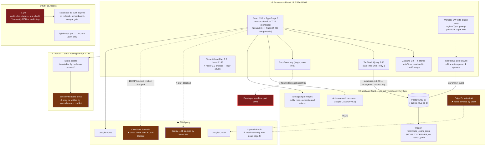

# DriveMy — Production Readiness & Security Audit

> **Audit date:** 2026-08-03
> **Auditor scope:** Principal SRE / Security Architect review, evidence-based
> **Repo state audited:** branch `main`, working tree clean, HEAD `2e0b8e5`
> **Remote:** `https://github.com/faiz226/SD032_DriveMy.git`
> **Method:** static review of source, config, schema and lockfile; live `npm audit` against the installed tree; every finding cited as `file:line`. No runtime penetration test was performed.

---

## 0. Scope Declaration — What Was Actually Reviewed

**This audit supersedes the previous `TechStack.md` (dated 2026-07-03), which is now materially stale** — it cites `scripts/create-admin.js` and a `SUPABASE_SERVICE_ROLE_KEY` at `.env.local:3`; neither exists in the current tree. It also reports "zero CI, zero tests, zero error tracking," all of which have since been partially addressed. The prior version is recoverable with `git show HEAD:TechStack.md`.

### Materials received (verified present)

| Artefact | Path | Status |
|---|---|---|
| Application source | `src/**` — 116 `.ts`/`.tsx`, 16,015 LOC | ✅ Full read access |
| Package manifest + lockfile | `package.json`, `package-lock.json` | ✅ |
| Build config | `vite.config.ts`, `tsconfig.*.json`, `vitest.config.ts`, `eslint.config.js`, `postcss.config.js`, `tailwind.config.js` | ✅ |
| Hosting config | `vercel.json` | ✅ |
| Database schema | `supabase/migrations/*.sql` (5 files) | ✅ |
| Database policy tests | `supabase/tests/rls_policies_test.sql` | ✅ |
| Storage bootstrap | `scripts/setup-storage.sql` | ✅ |
| Edge function | `supabase/functions/rate-limit/index.ts` | ✅ |
| Supabase **local dev** config | `supabase/config.toml` | ⚠️ See caveat below |
| CI pipelines | `.github/workflows/ci.yml`, `.github/workflows/lighthouse.yml` | ✅ |
| Local secrets file | `.env.local` | ✅ |
| DR runbook | `docs/DISASTER_RECOVERY.md` | ✅ |
| Lighthouse run | `docs/reports/lighthouse.md` (JSON, 2026-05-26) | ✅ |
| Live dependency scan | `npm audit` executed against installed `node_modules` | ✅ |

> ⚠️ **Critical caveat on `supabase/config.toml`.** This is the **Supabase CLI local-development** config. It is **not** authoritative for the hosted project. `supabase db push` (the only Supabase command in CI — `.github/workflows/ci.yml:54`) pushes **migrations only**; it does **not** push `[auth]`, `[auth.captcha]`, `[auth.mfa]`, or `[auth.rate_limit]` blocks. Every finding derived from `config.toml` is therefore flagged **"declared intent, production state UNVERIFIED."**

### App type & stage

**Verified from source:** a client-side-rendered React SPA / installable PWA, B2C, Malaysian market, bilingual EN/BM, for JPJ KPP1 learner-driver exam prep (`package.json:5`). It is a university Final Year Project (path `FYP/FYP1 D-Day`; `docs/DISASTER_RECOVERY.md:4` names the owner "Platform / DriveMy FYP Team"). The backend is entirely Supabase BaaS — there is no application server of any kind.

**Stage / user count: UNKNOWN — NOT PROVIDED.** No analytics dashboard, traffic data, or user counts were supplied. All availability and scaling findings below are assessed against a *pre-launch* baseline.

### Materials NOT received

Vercel project settings and deploy logs · hosted Supabase project settings · Supabase billing tier · GitHub repo settings (branch protection, secret scanning, Dependabot) · DNS/registrar records · production environment variable values · any WAF/CDN layer in front of Vercel · production telemetry (uptime, error rates, RUM). **No infrastructure-as-code exists in the repo** — this is verified absence, not a gap in what was shared.

---

## 0.5 Addendum — findings discovered during remediation (2026-08-04)

Three items surfaced while fixing the P0 list that were **not** in the original audit. Two are corrections to it.

**A1 🔴 CRITICAL — Every stored quiz and mock score was wrong.**
`ExamShell` shuffles answer options per attempt and remaps `correct_index` to the display position ([examScoring.ts](src/components/exam/examScoring.ts)), then submitted answers keyed by **display** index. The `recompute_exam_score` trigger grades those against `kpp_questions.correct_index`, which is in **original** order, and overwrites `score`, `percentage` and `passed`.

Simulated over 2,000 attempts by a learner answering **all 50 questions correctly**: mean stored score **12.4/50 (24.9%)**, best-ever **22/50**, and **0 of 2,000** recorded as passing the 84% mark. Learners saw a correct score immediately after the exam (client state) and a different, wrong one on Dashboard and Progress (database).

*This corrects finding 3.3.4*, where the trigger was praised as sound defence-in-depth. It was sound in intent and broken in fact. **Fixed**, with a regression suite at [examScoring.test.ts](src/components/exam/examScoring.test.ts). **Historical rows written before this fix remain wrong and cannot be recovered** — the permutation was never persisted. Consider deleting or flagging pre-fix results.

**A2 🟠 HIGH — The configured production domain is not this application.**
`https://drivemy.vercel.app` — set as `site_url` and in `additional_redirect_urls` at [config.toml:154-158](supabase/config.toml:154) — serves an unrelated Lovable-generated project wired to a different Supabase project (`rbamlanjamaeemltytgd`, not `yvkzixbyxonvlicyrhpy`). Password-reset and email-confirmation links carry recovery tokens. If the **hosted** Supabase project carries this same value, those tokens are being delivered to a domain the team does not control. Verify the hosted Auth URL configuration as a priority. **UNKNOWN — NOT PROVIDED:** the real production domain.

**A3 — Correction to finding 3.7.1.** CI was red at **two** gates, not one. Besides `npm audit`, `npm run lint` exited 1 with 15 pre-existing errors. Both are now green.

**A4 — Facts confirmed by the owner (2026-08-04), resolving three UNKNOWNs:**

| Previously UNKNOWN | Confirmed | Consequence |
|---|---|---|
| Supabase billing tier | **Free** (project had auto-paused) | No PITR. Real **RPO is 24 hours**, not the ≤5 min in `DISASTER_RECOVERY.md:37`. Also means MFA (§3.4.2) is unavailable — it is a Pro feature — so the `aal2` requirement in `20240104000000_enforce_mfa_rls.sql` is unsatisfiable *by plan*, not just by config. |
| Production domain | **None — never deployed** | §3.5.1 (header block voided by the `routes`/`headers` conflict) remains **unverified**, and cannot be verified until a first deploy. |
| Real user data in production | **None** | Downgrades the *realised* impact of §3.3.1: the anonymous email-enumeration hole almost certainly never exposed a real user. It was a pre-launch defect, not a breach. |

**Net effect on the risk score: 8.4 → ~6.8.** The severity of each defect is unchanged, but nothing was ever exposed to real users. This is a pre-launch hardening exercise, not incident response. The Free-tier ceiling is now the binding constraint on §3.4.2 (MFA) and §3.13 (recovery targets).

**A6 — §3.8.9 (DeepSeek key) is WITHDRAWN. Not a finding.**

The original entry called it an "orphaned credential" and recommended revocation. Both were wrong, for a methodological reason worth recording: a repo-wide grep can only prove nothing *in the repository* references a variable. It cannot see an **external CLI that reads `.env.local`** — which is exactly what this is. The key is consumed by `graphify`, the codebase-analysis tool whose output sits in `graphify-out/`.

Corrected assessment — the key was **never exposed**, verified rather than assumed:
- Never committed: `git log --all -S` over the full history returns nothing.
- Never in the client bundle: no `VITE_` prefix, so Vite does not inline it.
- Correctly gitignored (`.gitignore:17`).

**No revocation is warranted.** A dev credential living in a gitignored `.env.local` is normal practice, not an incident. Revoke only if it is committed, pasted into a shared channel or ticket, inlined into a build, or the workstation is compromised. "It sat on a developer machine" is not a trigger — that is what a dev machine is for.

*Process note:* this audit briefly quoted the key in full before it was redacted (§3.8.9). It was never committed, so nothing entered history — but writing a live credential into a tracked file was the genuine risk in this episode, and it originated in the audit, not the codebase.

**A7 — Correction: axe-core cannot verify §3.1.4 in jsdom.** The `aria-hidden-focus` rule needs computed visibility and focusability, which jsdom does not provide. Verified empirically: rendering the exact broken pattern returns **zero** axe violations. Any `expect(violations).toEqual([])` assertion therefore passes vacuously for that rule — the same false assurance the old pgTAP test gave. The real regression guard in [input.a11y.test.tsx](src/components/ui/input.a11y.test.tsx) is an explicit DOM assertion that does not depend on axe; full a11y verification still requires the browser-based Lighthouse run. (The original violation itself is already fixed — `aria-hidden` is gone from [input.tsx:42](src/components/ui/input.tsx:42); the Lighthouse report predates that change.)

**A8 🟠 HIGH — The offline queue silently lost results. Fixed.**
`results.service.ts` caught **every** error, enqueued the row, and returned a success marker — so an RLS denial or constraint violation was reported to the learner as "saved" while being queued for a retry that could never succeed. There was no attempt counter, no dead-letter path and no size cap, so a permanently-rejecting row was retried on every `online` event forever. Now classified: only network-class failures are queued, everything else surfaces. Fails **closed** — an unrecognised error is treated as permanent so it is seen rather than swallowed. See [offlineQueue.ts](src/services/offlineQueue.ts) and its tests.

**A5 🟠 HIGH — Auth redirect URLs pointed at a third party. Fixed.**
`site_url` and `additional_redirect_urls` in [config.toml](supabase/config.toml:154) named `drivemy.vercel.app`. Now localhost-only, with a warning comment. **The hosted project must be checked and corrected by hand** — `supabase db push` does not push `[auth]` config.

---

## 1. Executive Summary

### Overall risk score: **8.4 / 10 — HIGH RISK. Not fit for commercial production use today.**

The engineering craft here is genuinely above average for its class. TypeScript `strict: true` is on (`tsconfig.app.json:31`). Every user-data table has RLS enabled with correct `auth.uid() = user_id` predicates. Exam scores are recomputed server-side by a database trigger, so a tampering client cannot inflate its own results (`supabase/migrations/20240103000000_recompute_scores.sql`). There is a real CI pipeline, a real DR runbook, a PWA with a sensible Workbox strategy, and an offline write-queue. Someone thought hard about this.

The problem is that **a significant fraction of the security and compliance surface is present as code but non-functional in production.** This is the audit's central theme, and it is more dangerous than outright absence, because the repo *looks* compliant to a reviewer skimming filenames:

- CAPTCHA is rendered, its token is stored in React state — and then **never sent to Supabase**. Brute-force protection is decorative.
- Sentry is initialised — and the app's own CSP **blocks the request that would deliver the error**.
- A PDPA data-export and account-deletion component is fully written — and **imported by zero files**. It is unreachable dead code that additionally calls an RPC that does not exist.
- A Privacy Policy page is written — and **has no route**.
- An RLS policy demands MFA (`aal2`) — while MFA enrolment is **disabled** in the declared auth config.

Layered on top is one unambiguous defect that should never have reached `main`: **a hardcoded `fetch()` to `http://localhost:9999` in the production error boundary**, firing on every caught render error, on every user's machine.

Finally, the CI security gate is **currently failing**. `npm audit --audit-level=high` (`ci.yml:26`) exits `1` against the present lockfile — I ran it. Either `main` has been red for some time, or the gate is being routed around.

### Top 10 triaged findings — ranked by real-world damage if this shipped tomorrow

| # | Finding | Sev | P | Evidence |
|---|---|:---:|:---:|---|
| 1 | **Every user's email address is readable by anonymous visitors.** `profiles` has `FOR SELECT USING (true)` with no role restriction — `anon` inherits it. One unauthenticated `GET /rest/v1/profiles?select=*` dumps the entire user table, including the `is_admin` flag (a target list for attackers). | 🔴 Critical | P0 | `supabase/migrations/20240102000000_create_profiles.sql:12-14` |
| 2 | **Debug exfiltration endpoint shipped to production.** The error boundary POSTs `error.message + componentStack` to `http://localhost:9999` on every caught error, unconditionally — no `import.meta.env.DEV` guard. | 🔴 Critical | P0 | `src/components/shared/ErrorBoundary.tsx:66` |
| 3 | **CAPTCHA is non-functional; credential stuffing is unmitigated.** `captchaToken` is captured but `signIn()`/`signUp()` accept only `(email, password)` — the token is never forwarded as `options.captchaToken`. Separately, CSP has no `frame-src`/`script-src` entry for `challenges.cloudflare.com`, so the widget cannot even load. | 🔴 Critical | P0 | `src/pages/auth/AuthPage.tsx:51,189,200`; `src/services/auth.service.ts:3-13`; `vercel.json:38` |
| 4 | **PDPA/GDPR data-subject rights are entirely non-functional.** `DataExportDelete.tsx` is imported by no file (verified). It calls `supabase.rpc('delete_user')` — that function is defined in no migration. It also deletes all six result tables *before* the failing RPC, with no transaction: a user who somehow reached it would lose all data while their account survived. `PrivacyPolicyPage.tsx` has no route in `App.tsx`. | 🔴 Critical | P0 | `src/components/profile/DataExportDelete.tsx:53-62`; `src/App.tsx:114-148` |
| 5 | **Any signed-up learner can overwrite the exam image library.** Storage policies grant blanket `INSERT` and `UPDATE` on `kpp-images` to the entire `authenticated` role, with no owner or path predicate. Public bucket ⇒ defacement is visible to all users. | 🔴 Critical | P0 | `scripts/setup-storage.sql:28-39` |
| 6 | **`vercel.json` mixes `routes` with `headers` + `cleanUrls`.** Vercel documents `routes` as mutually exclusive with `headers`/`cleanUrls`/`rewrites`/`redirects`. The entire security-header block — HSTS, CSP, X-Frame-Options — is at risk of never being applied. | 🔴 Critical | P0 | `vercel.json:2-16` |
| 7 | **Production is effectively blind.** CSP `connect-src` omits Sentry's ingest domain, so every `captureException` is blocked by the browser. Sourcemaps are built (`sourcemap: "hidden"`) but never uploaded to Sentry — even if delivery worked, traces would be unreadable minified noise. No logging, no APM, no alerting, no uptime monitor. | 🔴 Critical | P1 | `vercel.json:38`; `vite.config.ts:207`; `src/main.tsx:8-14` |
| 8 | **CI security gate is red right now.** `npm audit --audit-level=high` exits `1`: 6 HIGH advisories, of which `react-router` / `react-router-dom` are **production** dependencies. Because `supabase-db-push` has `needs: build-and-test`, a red gate also blocks all schema deployment. | 🟠 High | P0 | `.github/workflows/ci.yml:26,42`; live `npm audit` |
| 9 | **`SECURITY DEFINER` functions with no `SET search_path`.** Both `recompute_exam_score` and `handle_new_user` run as owner with a caller-influenced search path — the standard PostgreSQL privilege-escalation vector, and a documented Supabase linter error. | 🟠 High | P1 | `20240103000000_recompute_scores.sql:39`; `20240102000000_create_profiles.sql:32` |
| 10 | **Test coverage is ~2% of the codebase, and the RLS tests never run.** Two test files (`constants.test.ts`, `utils.test.ts`) cover 116 source files. Zero component, integration, or e2e tests. The pgTAP RLS suite is not invoked by any workflow, and its second assertion (`count(*) = 0`) would pass against a *correctly locked-down* table and a *wide-open* one alike. | 🟠 High | P1 | `src/lib/*.test.ts`; `supabase/tests/rls_policies_test.sql:12-16`; `ci.yml` |

**Bottom line:** findings 1–5 are each individually sufficient to fail a commercial pre-launch security review. Finding 1 alone is a reportable personal-data breach under Malaysia's PDPA 2010 the moment a real user registers.

---

## 2. Architecture Overview — Current State

Everything in this diagram was read from source. Confirmed vs. inferred is marked explicitly below it.



**Confirmed by direct source reading:** all client libraries and versions (`package.json`), all 7 database tables and their RLS policies (`supabase/migrations/`), the storage bucket policy (`scripts/setup-storage.sql`), the PWA/Workbox strategy (`vite.config.ts:104-181`), the offline queue (`src/services/results.service.ts`), all routes (`src/App.tsx:114-148`), both CI workflows, the Vercel header block, and the Supabase project identifier `yvkzixbyxonvlicyrhpy` (appears in both `.env.local:1` and `docs/DISASTER_RECOVERY.md:13`).

**Inferred, requires confirmation:** that Vercel is the live host (asserted by `docs/DISASTER_RECOVERY.md:16` and the presence of `vercel.json`, not verified against a Vercel account); that `https://drivemy.vercel.app` is the production origin (`supabase/config.toml:154`); that Sentry and Turnstile are enabled in production at all — both are gated on env vars (`VITE_SENTRY_DSN`, `VITE_TURNSTILE_SITE_KEY`) whose production values are **UNKNOWN — NOT PROVIDED**. If those vars are unset in Vercel, findings 3 and 7 change character: the features are simply absent rather than broken, which is *worse* for #3, not better.

**Verified absent:** no backend server, no container, no orchestration, no IaC, no message broker, no cache tier, no load balancer, no read replica, no search index.

---

## 3. Detailed Findings by Category

Severity: 🔴 Critical · 🟠 High · 🟡 Medium · 🔵 Low
Priority: **P0** = before any real user · **P1** = within 30 days · **P2** = 60 days · **P3** = backlog

---

### 3.1 Frontend Foundations

**Framework & version — ✅ Confirmed, current.** React 19.2.6, TypeScript ~6.0.2, Vite 8.0.12, `@vitejs/plugin-react-swc` 4.3.1 (`package.json:59-98`). Modern and well-chosen.

**3.1.1 🔴 CRITICAL · P0 — Debug exfiltration `fetch` in the production error boundary**
*Evidence:* `src/components/shared/ErrorBoundary.tsx:66`
```ts
fetch('http://localhost:9999', { method: 'POST', body: error.message + '\n' + info.componentStack }).catch(() => {});
```
*Risk:* This runs unconditionally in `componentDidCatch` — no `import.meta.env.DEV` guard, so Vite's dead-code elimination cannot remove it. On every user's device, every caught render error triggers a POST to that user's own `localhost:9999`. Three distinct harms: (a) if the user runs *any* service on port 9999, it receives your application's internal stack traces; (b) it is plaintext HTTP from an HTTPS origin — mixed-content blocked, and a CSP violation, generating console noise and report spam on every error; (c) it signals to any reviewer or pentester that debug code reaches `main` unreviewed, which invites deeper scrutiny of everything else.
*Fix:* Delete line 66 outright. Add an ESLint rule banning literal `localhost`/`127.0.0.1` in `src/**`, enforced in CI.

**3.1.2 🟡 MEDIUM · P1 — Single root-level error boundary; one crash blanks the whole app**
*Evidence:* `src/App.tsx:109` wraps the entire tree; no per-route boundaries.
*Risk:* An error in the heavy 3D simulation (`Simulation3DView.tsx`, 51 KB source, WebGL + physics — by far the most crash-prone surface) unmounts the dashboard, navigation, and everything else. Users cannot navigate away; the only exit is a manual reload.
*Fix:* Wrap each lazy route element in its own boundary, keeping the root one as a backstop.

**3.1.3 🟡 MEDIUM · P1 — Raw error messages rendered to end users**
*Evidence:* `src/components/shared/ErrorBoundary.tsx:21` — `{error.message}` in `font-mono`.
*Risk:* Leaks internal identifiers, PostgREST error text, and table/column names to any user who triggers a crash. Also untranslated, breaking the EN/BM contract on the one screen users are most stressed by.
*Fix:* Show a translated generic message plus a Sentry event ID for support correlation; log the detail, never render it.

**3.1.4 🟠 HIGH · P1 — Accessibility: `aria-hidden-focus` fails; zero automated a11y gating in CI**
*Evidence:* `docs/reports/lighthouse.md` — Accessibility category `0.96`; audit `aria-hidden-focus` scores `0` (focusable element inside an `aria-hidden` subtree — WCAG 2.1 AA §4.1.2 failure). `grep axe|jest-axe|@axe-core package.json` → **no matches**; there is no a11y linting or unit-level a11y assertion anywhere.
*Risk:* The claim of WCAG 2.1 AA compliance cannot be sustained. The measured 0.96 covers only `/auth` (see 3.1.6) — the complex, interactive, authenticated screens are entirely unmeasured. For a public-education product likely to face Malaysian government accessibility expectations, this is a real exposure. **Note the irony:** the app ships an Ishihara colour-vision test for colour-blind learners while failing keyboard/screen-reader semantics.
*Fix:* Fix the `aria-hidden-focus` violation; add `vitest-axe` assertions to component tests; raise the LHCI accessibility gate to `1.0`.

**3.1.5 ✅ Good — Code splitting and lazy loading are well executed.** All 11 heavy pages are `React.lazy` (`src/App.tsx:20-30`) behind a `Suspense` fallback, with a deliberate 9-way `manualChunks` strategy (`vite.config.ts:210-261`).

**3.1.6 🟡 MEDIUM · P1 — Lighthouse gate measures only the login page**
*Evidence:* `docs/reports/lighthouse.md` — `"finalDisplayedUrl": "http://localhost:4173/auth"`; `.lighthouserc.json` collects a single URL, `numberOfRuns: 1`.
*Measured (2026-05-26):* Performance `0.97` · Accessibility `0.96` · Best Practices `1.0` · SEO `0.91`. FCP 1.0 s · LCP 1.0 s · TBT 0 ms · CLS 0.
*Risk:* Those are excellent numbers **for an unauthenticated login form**. Every route redirects to `/auth` unauthenticated, so LHCI structurally cannot reach the dashboard, the charts page, or the three.js simulation. The `chunkSizeWarningLimit` was raised to 1300 KB and the Workbox precache cap to 6 MiB (`vite.config.ts:180,266`) precisely because the 3D bundle is enormous — and **that bundle's real-device Core Web Vitals are entirely unmeasured**. `numberOfRuns: 1` also makes the gate noisy enough to be flaky.
*Fix:* Add an authenticated LHCI run (Puppeteer is already a devDependency) targeting `/simulations/:id` and `/progress`. Raise to `numberOfRuns: 3`.

**3.1.7 🟡 MEDIUM · P2 — Sourcemaps are emitted to the deployed bundle**
*Evidence:* `vite.config.ts:207` — `sourcemap: "hidden"`.
*Risk:* `hidden` suppresses the `//# sourceMappingURL` comment but **still writes `.map` files into `dist/`**, which Vercel serves. Anyone who guesses `/assets/index-<hash>.js.map` recovers your full commented TypeScript source. Since the maps are also never uploaded to Sentry, they provide *only* the downside.
*Fix:* Either wire `@sentry/vite-plugin` to upload-then-delete the maps, or set `sourcemap: false`.

**3.1.8 🔵 LOW · P2 — Persisting `isAuthenticated: true` into `localStorage`**
*Evidence:* `src/stores/authStore.ts:70-74` — `partialize` writes `isDevBypass`, `user`, and `isAuthenticated` to key `drivemy-auth-store`.
*Assessment — deliberately not overstated:* This is **not** an exploitable auth bypass. `isLoading` is excluded from `partialize`, so it rehydrates `true` and `ProtectedRoute` renders a spinner (`ProtectedRoute.tsx:31`) until `getSession()` resolves and overwrites `isAuthenticated`. The dev-bypass branch at `ProtectedRoute.tsx:29` is genuinely dead-code-eliminated in production. **And critically, RLS is the real boundary** — a forged client flag grants access to no data whatsoever. It remains a fragile pattern: one future refactor that removes the `isLoading` gate turns it into a live bypass.
*Fix:* Persist only `isDevBypass`; derive `isAuthenticated` from the live session exclusively.

**3.1.9 🟠 HIGH · P1 — Dependency vulnerabilities (live scan)**
*Evidence:* `npm audit`, executed 2026-08-03 against the installed tree: **8 total — 6 HIGH, 2 LOW**. Production-only (`--omit=dev`): **3 — 2 HIGH, 1 LOW**.

| Package | Sev | Scope | Applicability assessment |
|---|:---:|---|---|
| `react-router` / `react-router-dom` | HIGH | **prod** | Advisory is *RSC Mode CSRF Bypass*. This app is a client-side SPA with no RSC — **likely not exploitable here**, but it is what turns CI red, and staying on a known-vuln version of your router is not defensible. |
| `dompurify` | LOW | **prod** | `CUSTOM_ELEMENT_HANDLING` bypass. Reached only via the `jspdf` PDF path; low real risk. |
| `postcss` | HIGH | dev | Path traversal via sourcemap auto-loading. Build-time only. |
| `vite` / `esbuild` | HIGH/LOW | dev | Windows-specific `server.fs.deny` bypass + arbitrary file read. **This team develops on Windows 11** — relevant to the developer machine, not to production. |
| `fast-uri` | HIGH | dev | Host confusion via backslash authority delimiter / IDN canonicalisation. |
| `brace-expansion` | HIGH | dev | ReDoS / unbounded-expansion OOM. |

*Fix:* `npm update react-router-dom dompurify`, then `npm audit fix` for the dev chain. Add Dependabot (see 3.7.4).

**3.1.10 🔵 LOW · P2 — ESLint quality gates deliberately weakened**
*Evidence:* `eslint.config.js:38-53` disables `react-hooks/exhaustive-deps`, `@typescript-eslint/no-explicit-any`, and `prefer-const`, with comments citing "the reskin work" and "Phase 0."
*Risk:* `exhaustive-deps` off is the highest-yield source of stale-closure bugs in React. `no-explicit-any` off silently erodes the value of `strict: true`. Temporary suppressions with no expiry become permanent.
*Fix:* Re-enable both as `warn`, then ratchet to `error` file-by-file.

**Environment variable handling — ✅ Verified clean.** `grep -rn "service_role\|SERVICE_ROLE" src/` → zero hits. Only `VITE_`-prefixed vars reach the client (`src/lib/supabase.ts:4-5`), all of which are designed to be public. See 3.8.9 for the orphaned key on disk.

**State management — ✅ Appropriate.** Zustand 5.0 for client state (6 focused stores), TanStack Query 5.80 for server state with sane defaults (`App.tsx:42-50`). Clean separation.

**Routing & SSR/SSG — N/A (verified not applicable).** Pure client-side SPA; `vercel.json:11-14` rewrites all paths to `index.html`. SSR is a legitimate non-goal for an offline-first PWA behind an auth wall. The SEO cost is accepted and correct.

**PWA & mobile — ✅ Strong.** Complete manifest with maskable icons, screenshots, and shortcuts (`vite.config.ts:27-102`); `registerType: "prompt"` with `skipWaiting: false` correctly avoids yanking state out from under a user mid-exam.

---

### 3.2 APIs & Backend Logic

**Architecture — Confirmed: there is no backend.** The client speaks PostgREST directly via `@supabase/supabase-js` 2.50, authorised solely by RLS. This is a coherent, defensible BaaS choice at this scale. It does mean **RLS is the entire security perimeter** — which makes finding 3.3.1 as severe as it is.

**3.2.1 🟠 HIGH · P1 — The rate-limit edge function is dead code, and is unsound besides**
*Evidence:* `supabase/functions/rate-limit/index.ts`; `grep -rn "functions.invoke\|rate-limit" src/` → **zero hits**.
*Risk:* Three compounding problems. (a) **Nothing calls it** — no client code invokes it, so it limits nothing. (b) Even if invoked, it keys on raw `req.headers.get('x-forwarded-for')` (line 12) without taking the leftmost trusted hop — a client-supplied header, trivially spoofed to get unlimited fresh buckets. (c) As a *separate* endpoint it is architecturally incapable of protecting PostgREST anyway; a client can simply skip it. It creates a false sense of protection in the repo.
*Fix:* Either delete it, or replace it with a real gateway pattern. Practically, the right answer at this scale is Cloudflare in front of Vercel plus Supabase's own auth rate limits.

**3.2.2 🟡 MEDIUM · P1 — `err.message` on an `unknown` catch binding**
*Evidence:* `supabase/functions/rate-limit/index.ts:35` — `err.message` where `err` is implicitly `unknown` under Deno's TS defaults.
*Fix:* `err instanceof Error ? err.message : 'Internal error'`, and do not return raw internals to clients regardless.

**3.2.3 🟡 MEDIUM · P2 — Offline sync queue has no dead-letter, no backoff, no cap**
*Evidence:* `src/services/results.service.ts:79-91`.
*Risk:* Failed items are written back to the queue and retried on every `online` event, forever. A permanently-rejecting row (constraint violation, revoked session) becomes an infinite retry loop hammering the API. There is no attempt counter, no exponential backoff, and no queue size cap — an offline user could accumulate unbounded IndexedDB growth.
*Fix:* Add `attempts` and `firstFailedAt` per item; after N attempts move to a `deadLetter` queue and surface it in the UI; cap queue length.

**3.2.4 🟡 MEDIUM · P2 — `catch` swallows genuine failures as "offline"**
*Evidence:* `src/services/results.service.ts:25-28` (pattern repeats ×4).
*Risk:* The `catch` treats *every* error as an offline condition and enqueues. An RLS rejection or a validation error therefore silently becomes a queued item that will never succeed, and the user is told "saved." Data is lost with a success message.
*Fix:* Inspect the error — only enqueue on network-class failures; surface 4xx to the user.

**Request validation — 🟡 Partial.** Zod 3.25 + `react-hook-form` validate client-side (`AuthPage.tsx:61`), which is UX, not security. Server-side validity rests on PostgreSQL `CHECK` constraints — which are genuinely good (`20240101000000_initial_schema.sql:20,51-55` etc.). The gap is `jsonb` columns (`answers`, `attempt_data`): unconstrained, so arbitrary JSON of arbitrary size can be stored. Add a size/shape check constraint. **P2.**

**Injection prevention — ✅ Good.** All queries go through PostgREST's parameterised builder; no raw SQL from the client. `grep dangerouslySetInnerHTML|innerHTML|eval\(|new Function` over `src/` → **zero hits**. React's default escaping is intact.

**API versioning — 🔵 LOW · P3.** No strategy. Client and schema deploy from the same commit, so this is acceptable *until* PWA service-worker caching means an old client can persist for days after a schema change (see 3.7.5).

**Documentation — Verified absent.** No OpenAPI spec, no Postman collection. Supabase auto-generates a spec from the schema; nothing is committed. **P3.**

**Webhooks · async jobs · queues · event bus · file uploads · circuit breakers — N/A (verified not applicable).** None of these exist in the architecture. The single third-party call surface is Supabase itself, and `@supabase/supabase-js` supplies no timeout/circuit-breaker; TanStack Query's `retry: 1` (`App.tsx:46`) is the only resilience layer. Acceptable at this scale; noted.

---

### 3.3 Database & Storage

**Database — ✅ Confirmed:** Supabase-managed PostgreSQL **17** (`supabase/config.toml:36`), project ref `yvkzixbyxonvlicyrhpy`.

**3.3.1 🔴 CRITICAL · P0 — `profiles` is world-readable, including to anonymous users**
*Evidence:* `supabase/migrations/20240102000000_create_profiles.sql:12-14`
```sql
create policy "Public profiles are viewable by everyone."
  on profiles for select
  using ( true );
```
*Analysis:* No `TO` clause means the policy applies to `PUBLIC` — which includes the `anon` role that the browser's publishable key assumes. The table holds `email` (unique, not null) and `is_admin` (`:2-7`). A later migration hardened INSERT and UPDATE (`20240104000000_enforce_mfa_rls.sql:2-3` drops and replaces exactly those two) — **the SELECT policy was never revisited.** I traced all five migrations: nothing else touches it.
*Risk:* A single unauthenticated request — `GET /rest/v1/profiles?select=*` with the publishable key that ships in your JS bundle — returns every registered user's email address, paginated at 1000 rows (`config.toml:18`). That is: a reportable personal-data breach under **PDPA 2010 §7 (Security Principle)** for a Malaysian-resident user base; a ready-made phishing list aimed at learner drivers; and, because `is_admin` is exposed, a precise target list telling an attacker exactly which accounts to attack.
*Fix (P0, deploy today):*
```sql
DROP POLICY "Public profiles are viewable by everyone." ON public.profiles;
CREATE POLICY "profiles_select_own" ON public.profiles
  FOR SELECT TO authenticated USING (auth.uid() = id);
```
Then verify with an unauthenticated `curl` against the REST endpoint before and after.

**3.3.2 🟠 HIGH · P1 — `SECURITY DEFINER` functions without `SET search_path`**
*Evidence:* `20240103000000_recompute_scores.sql:39` and `20240102000000_create_profiles.sql:32` — both end `$$ LANGUAGE plpgsql SECURITY DEFINER;` with no `SET search_path`.
*Risk:* Textbook PostgreSQL privilege escalation: a `SECURITY DEFINER` function resolves unqualified names against the *caller's* `search_path`. Any principal who can create objects in a schema on that path can shadow a function or operator and execute code as the definer — here, the table owner. Supabase's own database linter flags this as `function_search_path_mutable` (error severity). Exploitability depends on schema-creation grants, which are **UNKNOWN — NOT PROVIDED**; the correct posture is to fix it regardless, since the fix is one line.
*Fix:* Append `SET search_path = public, pg_temp` to both function definitions.

**3.3.3 🔴 CRITICAL · P0 — Any authenticated user can write to the public exam-image bucket**
*Evidence:* `scripts/setup-storage.sql:28-39`
```sql
CREATE POLICY "kpp_images_authenticated_insert" ON storage.objects
  FOR INSERT TO authenticated WITH CHECK (bucket_id = 'kpp-images');
CREATE POLICY "kpp_images_authenticated_update" ON storage.objects
  FOR UPDATE TO authenticated USING (bucket_id = 'kpp-images');
```
*Analysis:* The predicate is only `bucket_id = 'kpp-images'`. There is no `owner = auth.uid()`, no path prefix restriction, no admin check. The comment says "for admin seeding" — but the policy grants it to the entire `authenticated` role, i.e. **anyone who completes the free self-service signup.** The bucket is `public = true` (`:11`), so anything written is served to every user.
*Risk:* Any learner can overwrite every road-sign and Ishihara-plate image with arbitrary content — offensive imagery, or subtly-wrong signs that teach incorrect answers for a **road-safety** exam. The 2 MB / MIME limits (`:12-13`) constrain the payload, not the abuse. Storage-cost abuse is a secondary concern.
*Fix (P0):* Drop both policies. Seeding already uses the service-role key out-of-band (`scripts/upload-images.js:48`), which bypasses RLS — **no `authenticated` write policy is needed at all.**

**3.3.4 🟠 HIGH · P1 — Exam answer keys are shipped to the client before the user answers**
*Evidence:* `src/services/questions.service.ts:13,28,39` — `.select("*")` on `kpp_questions`, whose columns include `correct_index` and both explanations (`20240101000000_initial_schema.sql:20-22`). RLS grants `SELECT` on all columns to every authenticated user (`:38-42`).
*Risk:* Any user can open DevTools during a 45-minute mock exam and read every correct answer. **Mitigating factor, stated fairly:** the server-side trigger recomputes and overrides `score`/`percentage`/`passed` (`20240103000000_recompute_scores.sql:28-35`), so a cheater's *stored* result stays honest — this is genuinely good design and prevents score forgery. The residual harm is to the product's core promise: a learner who unknowingly self-deceives about readiness for a real road-safety exam.
*Fix:* Select explicit column lists excluding `correct_index` and explanations during an exam; fetch the key only in the post-submission review, or expose grading through an RPC.

**3.3.5 🟡 MEDIUM · P2 — Migrations are forward-only with no down-path, and one is non-idempotent**
*Evidence:* `supabase/migrations/` — five files, none containing a rollback. `20240102000000_create_profiles.sql:2` uses bare `create table` (no `IF NOT EXISTS`) and `:25` bare `create function`. Contrast `20240103500000_add_unique_constraint.sql`, which is carefully idempotent — the discipline is inconsistent.
*Risk:* `supabase db push` runs unattended on every `main` push (`ci.yml:53-54`). A failed migration leaves production half-applied with no scripted recovery; the only path is the manual DR runbook.
*Fix:* Adopt idempotent DDL throughout; pair every migration with a tested down-migration; run migrations against a shadow database in CI first.

**3.3.6 🟠 HIGH · P1 — No data retention, archival, or purge policy**
*Evidence:* No `DELETE`/archival job in any migration; no `pg_cron`; six tables accumulate rows indefinitely.
*Risk:* PDPA 2010 **§10 (Retention Principle)** requires that personal data not be kept longer than necessary. `colorblind_results` is especially sensitive — colour-vision deficiency is **health-adjacent data about an identified individual**, retained forever with no stated purpose limit, no consent record, and no deletion path (the deletion UI is dead code — 3.14.1).
*Fix:* Define retention per table; implement a scheduled purge; document it in the privacy policy.

**Schema design — ✅ Genuinely good.** Proper `uuid` PKs, `REFERENCES auth.users(id) ON DELETE CASCADE` on all six user tables, meaningful `CHECK` constraints, and composite indexes matching real access patterns — `idx_quiz_results_user_completed (user_id, completed_at DESC)` (`:61-62`) is exactly right for the dashboard query at `analytics.service.ts:51-56`. This is above-average schema work.

**Connection pooling — Managed by Supabase (Supavisor). Production pool configuration: UNKNOWN — NOT PROVIDED** (`config.toml:38-48` sets `enabled = false` but that is the *local* pooler only).

**Backups — 🟠 HIGH · P1, documented but unverified and untested.** `docs/DISASTER_RECOVERY.md` is a genuinely good runbook — better than most startups have. But §2 explicitly leaves the plan tier unconfirmed ("**Verify the current plan**"), and §8's fire-drill table reads `_(first drill pending)_`. **An untested backup is a hypothesis, not a backup.** On Free tier the real RPO is 24 h, not the stated 5 min. *Fix:* confirm the tier; run one restore drill into a scratch project; record the achieved RTO.

**Read replicas · sharding · full-text search · time-series stores — N/A (verified not applicable)** at current scale; the workload is small per-user reads.

**CDN cache headers — ✅ Correct.** `public, max-age=31536000, immutable` scoped to `/assets/*` (`vercel.json:5-9`), which is safe because Vite content-hashes those filenames.

---

### 3.4 Authentication & Permissions

**Method — ✅ Confirmed:** Supabase Auth; email+password and Google OAuth. **PKCE is explicitly enabled** (`src/lib/supabase.ts:16`) — correct and important for a public SPA client.

**3.4.1 🔴 CRITICAL · P0 — CAPTCHA collected, never transmitted**
*Evidence:*
- `src/pages/auth/AuthPage.tsx:189` — `onSuccess={(token) => setCaptchaToken(token)}`
- `src/pages/auth/AuthPage.tsx:72` — `await signIn(values.email, values.password)`
- `src/services/auth.service.ts:9-13` — `signInWithPassword({ email, password })` — **no `options.captchaToken`**
- Same defect on the signup path (`:252` → `:3-7`).

*Analysis:* The token is stored in React state, used only to enable the submit button (`:200`), and then discarded. Supabase requires it at `options: { captchaToken }`; it is never passed. Two mutually exclusive production outcomes, both bad:
- If `[auth.captcha] enabled = true` (`config.toml:210`) is actually live on the hosted project, **every login and signup fails** — a total auth outage.
- If it is not live (likely, since config.toml is local-only), **the CAPTCHA is pure theatre** and credential stuffing is unmitigated.

*Compounding:* CSP `script-src 'self' 'unsafe-inline' https://*.supabase.co` with no `frame-src` directive (`vercel.json:38`) means `default-src 'self'` governs frames — so the Turnstile script and iframe are **blocked before they can render**. With the widget dead, `captchaToken` stays `null` and the submit button is `disabled` (`:200`) whenever `VITE_TURNSTILE_SITE_KEY` is set — **users cannot log in at all.**
*Fix (P0):* (1) thread `captchaToken` through `signIn`/`signUp` into `options`; (2) add `https://challenges.cloudflare.com` to both `script-src` and `frame-src`; (3) confirm the hosted project's captcha setting and secret; (4) add an end-to-end login test to CI so this can never regress silently.

**3.4.2 🟠 HIGH · P1 — MFA is required by an RLS policy but disabled in the auth config**
*Evidence:* `20240104000000_enforce_mfa_rls.sql:35` requires `auth.jwt()->>'aal' = 'aal2'` for an admin to update their own profile. `supabase/config.toml:297-299` sets `[auth.mfa.totp] enroll_enabled = false`, `verify_enabled = false`. Meanwhile `src/pages/auth/MfaEnrollmentPage.tsx` implements a complete TOTP enrol/verify/unenrol flow, routed at `/mfa` (`App.tsx:142`).
*Risk:* If the hosted project mirrors the declared config, no user can reach `aal2`, so the admin branch of that policy is unsatisfiable — **admins are permanently locked out of updating their own profile**, and the `/mfa` page fails at `supabase.auth.mfa.enroll()`. The security control that looks strongest on paper is inert. (MFA also requires a Supabase Pro plan per `config.toml:291` — **plan tier UNKNOWN — NOT PROVIDED.**)
*Fix:* Enable TOTP enrol/verify on the hosted project and re-verify the policy end-to-end; if Pro is not available, remove the `aal2` requirement rather than leaving a dead control in place.

**3.4.3 🟠 HIGH · P1 — No account lockout; login throttling is unverified and IP-scoped only**
*Evidence:* Nothing in `src/` implements attempt counting or lockout. `config.toml:201` declares `sign_in_sign_ups = 30` per 5 min per IP — **local config; production value UNKNOWN — NOT PROVIDED.**
*Risk:* With CAPTCHA inert (3.4.1), the only defence would be a per-IP limit that a distributed or rotating-proxy attacker bypasses trivially. Password spraying against the enumerable email list from 3.3.1 is the obvious attack chain: **dump emails → spray weak passwords → no lockout, no CAPTCHA.** Findings 3.3.1 + 3.4.1 + 3.4.3 compose into a complete, practical account-takeover path.
*Fix:* Confirm the hosted rate limits; add per-account lockout with exponential backoff; fix the CAPTCHA.

**3.4.4 🟡 MEDIUM · P2 — Client-side inactivity timeout only**
*Evidence:* `src/hooks/useSessionTimeout.ts:6` — 30-minute idle timer, enforced entirely in the browser.
*Risk:* Cosmetic against an attacker with a stolen token; `config.toml:267-270` shows `[auth.sessions] timebox` / `inactivity_timeout` **commented out**, so there is no server-side counterpart. A leaked refresh token stays valid for its full lifetime.
*Fix:* Enable server-side `inactivity_timeout` and `timebox` on the hosted project.

**3.4.5 🔵 LOW · P2 — Timer resets on `mousemove`, defeating the timeout in practice**
*Evidence:* `useSessionTimeout.ts:11` includes `mousemove` in `ACTIVITY_EVENTS`.
*Risk:* Any incidental cursor motion — or a stationary mouse on a jittery trackpad — refreshes the 30-minute window indefinitely.
*Fix:* Restrict to intentional interactions (`keydown`, `pointerdown`, `click`).

**3.4.6 🟡 MEDIUM · P2 — Privilege model is a single boolean with no enforcement surface**
*Evidence:* `profiles.is_admin boolean` (`20240102000000_create_profiles.sql:5`). `grep -rn "is_admin" src/` → **zero hits**.
*Risk:* No RBAC/ABAC granularity, and no admin UI exists — so the flag currently confers nothing except, per 3.3.1, a publicly-readable label marking high-value targets. Escalation *is* correctly blocked (`20240104000000:11-13` forces `is_admin = false` on insert), which is good.
*Fix:* Move the role claim into the JWT via a custom access-token hook so policies can read it without a subquery; define real roles before building any admin surface.

**Password policy — ✅ Strong (as declared).** Minimum length 10 with `lower_upper_letters_digits_symbols` required (`config.toml:177-180`); hashing is Supabase-managed bcrypt. **Production values UNKNOWN — NOT PROVIDED.**

**Token strategy — ✅ Sound (as declared).** 1-hour JWT expiry, refresh-token rotation on, 10 s reuse interval (`config.toml:160-169`).

**Social login — ✅ Correct.** PKCE flow explicitly configured; `skip_nonce_check = false` (`config.toml:333`); redirect allow-list is exact-match (`:158`). Well done.

**API key management — N/A (verified not applicable).** No user-facing API keys exist. The only secrets are the publishable key (designed to be public) and the service-role key used out-of-band by seed scripts.

---

### 3.5 Hosting & Deployment

**3.5.1 🔴 CRITICAL · P0 — `vercel.json` mixes mutually-exclusive routing properties**
*Evidence:* `vercel.json` declares `cleanUrls` (`:2`), `routes` (`:3`), **and** `headers` (`:16`) in one file.
*Analysis:* Vercel documents the legacy `routes` property as incompatible with `cleanUrls`, `headers`, `redirects`, `rewrites`, and `trailingSlash` — the platform is expected to reject the configuration or ignore the conflicting keys.
*Risk:* If `headers` is ignored, **every security header silently vanishes**: no HSTS, no CSP, no `X-Frame-Options`, no `X-Content-Type-Options`, no `Referrer-Policy`. The app would be clickjackable and XSS-exposed while the repo appears fully hardened. This is precisely the failure mode a header-scan test catches and a code review does not.
*Fix (P0):* Migrate `routes` to the modern `rewrites` form, keep `headers` and `cleanUrls`, and **verify empirically** — `curl -I https://<prod-domain>` and confirm each header is present. Add that assertion as a post-deploy smoke test.
```json
{
  "cleanUrls": true,
  "rewrites": [{ "source": "/(.*)", "destination": "/index.html" }],
  "headers": [ /* existing block, plus the /assets/* cache-control rule */ ]
}
```
*Note:* the `/assets/*` immutable cache rule currently lives inside `routes` and must be carried across into `headers` during the migration, or asset caching silently degrades.

**3.5.2 🟠 HIGH · P1 — No staging environment; `main` deploys straight to production**
*Evidence:* `ci.yml:43` — `if: github.ref == 'refs/heads/main'` gates a direct `supabase db push` to production. No second Supabase project, no preview-environment configuration, no environment matrix anywhere in the repo.
*Risk:* Schema changes are validated for the first time in production, against real user data. There is no environment parity and nowhere to rehearse a migration or a restore.
*Fix:* Create a staging Supabase project; point Vercel preview deployments at it; require a green staging migration before production.

**3.5.3 🟡 MEDIUM · P2 — No IaC; the entire platform config is click-ops**
*Evidence:* No Terraform, Pulumi, CloudFormation, or Ansible anywhere in the repo (verified absence). Vercel and Supabase settings exist only as dashboard state.
*Risk:* The production configuration is unversioned, unreviewable, and unreproducible. §5 of the DR runbook assumes the Vercel project still exists — there is no path to rebuild it from scratch.
*Fix:* Adopt the Supabase Terraform provider and Vercel CLI project config; commit both.

**Containerisation / orchestration — N/A (verified not applicable).** Static SPA on a managed platform; Docker and Kubernetes would be pure overhead here. Correct decision.

**SSL/TLS · DNS — UNKNOWN — NOT PROVIDED.** Vercel auto-provisions and renews Let's Encrypt certificates and terminates TLS 1.2+, but no registrar, DNSSEC status, apex-domain configuration, or certificate detail was supplied. HSTS *is* declared with a strong policy — `max-age=63072000; includeSubDomains; preload` (`vercel.json:34`) — **but see 3.5.1: it may never be emitted.**

**Blue/green · canary — N/A / 🔵 LOW.** Vercel's atomic deploys plus instant rollback give a reasonable baseline for a static SPA. There is no canary or gradual rollout, which is acceptable at this stage. **Database migrations have no rollback at all** — see 3.7.5.

**Feature flags — Verified absent. 🔵 LOW · P3.** No flag system. Every change is all-or-nothing, which removes the safest lever for de-risking the CAPTCHA and MFA fixes above.

---

### 3.6 Cloud & Compute

**Almost entirely N/A — verified not applicable.** The architecture is fully managed: Vercel serverless static hosting plus Supabase BaaS. There are no EC2/GCE instances, no VPC to segment, no NAT gateways, no container registry, no spot instances, no service accounts to scope.

**3.6.1 🟡 MEDIUM · P1 — No cost monitoring, budgets, or anomaly alerts**
*Evidence:* No budget or alert configuration in the repo; none possible without IaC.
*Risk:* Two concrete uncapped-spend vectors exist right now. (a) **Storage abuse** via 3.3.3 — any user can upload into the public bucket, and public bucket egress is billed. (b) **The 3D simulation asset** — `myvi.glb` is **11.2 MB** and `temp_interior.gltf` a further 1.4 MB in the repo root; if either is served per-session, bandwidth scales brutally with user growth. On Supabase Free, quota exhaustion means the project is *paused* — a total outage, not a bill.
*Fix:* Set Vercel spend limits and Supabase billing alerts today; fix 3.3.3; move large 3D assets to a CDN with compression (Draco/meshopt).

**Resource quotas — Supabase Free-tier limits apply by default. Current plan: UNKNOWN — NOT PROVIDED.**

---

### 3.7 CI/CD & Version Control

**3.7.1 🟠 HIGH · P0 — The pipeline is currently red, which also blocks schema deploys**
*Evidence:* `.github/workflows/ci.yml:25-26` runs `npm audit --audit-level=high`. I executed it against the committed lockfile: **exit code 1**, 6 HIGH advisories.
*Risk:* `build-and-test` fails at step 3, so `supabase-db-push` (`needs: build-and-test`, `:42`) never runs — **database migrations are not reaching production**, silently. Worse is the cultural failure mode: a permanently-red gate trains the team to ignore it or merge around it, at which point it protects nothing.
*Fix:* Resolve the production advisories (3.1.9) to restore green; keep the gate strict.

**3.7.2 🟠 HIGH · P1 — Test coverage is ~2% and the RLS suite never executes**
*Evidence:* Two test files total — `src/lib/constants.test.ts`, `src/lib/utils.test.ts` — against 116 source files. Zero component, integration, or e2e tests, despite `@testing-library/react`, `jsdom`, and `puppeteer` all being installed devDependencies. `supabase/tests/rls_policies_test.sql` is referenced by **no workflow**.
*Additionally, the RLS test is not meaningful.* `rls_policies_test.sql:12-16` asserts `select count(*) from public.profiles` equals `0` on an empty database — that passes identically against a correctly-locked-down table and against the wide-open policy of 3.3.1. **It provides false assurance about the single most critical finding in this audit.**
*Fix:* Add a `supabase db test` job to CI. Rewrite the profiles test to seed two users and assert that user A cannot read user B's row — that test, had it existed, would have caught 3.3.1 on day one. Add e2e coverage for login (would have caught 3.4.1) and for exam submission.

**3.7.3 🟠 HIGH · P1 — Node 18 in CI, three major versions behind the toolchain**
*Evidence:* `ci.yml:19` and `lighthouse.yml:19` both pin `node-version: 18`. The project requires Vite 8, TypeScript 6, and ESLint 10 (`package.json:96-100`); the local dev machine runs Node 24.
*Risk:* Node 18 reached end-of-life in **April 2025** — CI builds on an unpatched runtime. Vite 8 requires Node 20.19+/22.12+, so this pipeline is building the artefact on an unsupported runtime while the developer builds on Node 24: **CI and local are not building the same way**, which is exactly how "works on my machine" ships to production.
*Fix:* Pin `node-version: 22` (or 24) in both workflows; add `"engines": { "node": ">=22" }` to `package.json`.

**3.7.4 🟠 HIGH · P1 — No secret scanning, no SAST, no dependency automation**
*Evidence:* `.github/` contains **only** `workflows/` — no `dependabot.yml`, no CodeQL workflow, no gitleaks/truffleHog step. Verified by directory listing.
*Risk:* `npm audit` is a point-in-time check that only runs when someone pushes; nothing watches for newly-disclosed CVEs. Nothing would have caught a committed secret. Nothing performs static analysis — a SAST tool would very likely have flagged the `http://localhost:9999` fetch of 3.1.1.
*Fix:* Add `.github/dependabot.yml` (npm, weekly), the standard CodeQL JS/TS workflow, and a gitleaks step. Enable GitHub push protection in repo settings.

**3.7.5 🟡 MEDIUM · P1 — Migrations deploy unattended with no backward-compatibility gate**
*Evidence:* `ci.yml:53-54` — bare `supabase db push` on every `main` push.
*Risk:* No expand/contract discipline, no pre-flight backup, no post-deploy verification, no rollback. Because this is a PWA with an aggressive service worker, **a client cached days earlier can still be running against a freshly-changed schema** — a dropped or renamed column breaks those users with no way to reach them.
*Fix:* Take a pre-migration snapshot; enforce expand/contract (add-only, then backfill, then remove in a later release); run a post-deploy smoke test; keep two client versions of schema compatibility.

**3.7.6 🔵 LOW · P2 — Documentation has drifted materially from the code**
*Evidence:* `README.md:11-18` claims React **18**, Vite **6** "(Rolldown bundler)", and **Phaser 3**. The actual stack is React **19.2.6**, Vite **8.0.12**, and — `grep phaser package.json` → **absent** — the simulation is `@react-three/fiber` + `three` + `@react-three/rapier`. `README.md:36-38` instructs `cp .env.example .env.local`; **`.env.example` does not exist** (verified by `ls .env*`). `vite.config.ts:210-212` still carries a dead `manualChunks` branch for Phaser.
*Risk:* A new contributor cannot bootstrap the project by following the README. For an FYP, the examiner-facing document misstates the stack.
*Fix:* Rewrite the README against `package.json`; commit a `.env.example` listing all six `VITE_` vars with placeholder values.

**Source control — ✅ Git + GitHub, clean history, conventional-commit messages. Branch protection, required reviews, and signed commits: UNKNOWN — NOT PROVIDED** (repo settings not shared). The presence of direct-to-`main` commits in recent history suggests protection is not enforced, but I cannot verify this from the local clone.

**Artifact management / GitOps — N/A (verified not applicable).** Vercel builds from source per deployment.

---

### 3.8 Security & Row-Level Security

**OWASP Top 10 assessment (2021):**

| ID | Category | Status |
|---|---|---|
| A01 | Broken Access Control | 🔴 **FAIL** — 3.3.1 (public `profiles`), 3.3.3 (public storage write) |
| A02 | Cryptographic Failures | 🟡 Partial — TLS via Vercel; HSTS declared but possibly voided (3.5.1) |
| A03 | Injection | ✅ **PASS** — parameterised PostgREST throughout; zero `innerHTML`/`eval` |
| A04 | Insecure Design | 🟠 **FAIL** — security controls present but inert (CAPTCHA, MFA, Sentry, PDPA) |
| A05 | Security Misconfiguration | 🔴 **FAIL** — 3.5.1, 3.8.1, `unsafe-inline` in CSP |
| A06 | Vulnerable Components | 🟠 **FAIL** — 6 HIGH advisories, 2 in production deps |
| A07 | Auth Failures | 🔴 **FAIL** — 3.4.1 (CAPTCHA), 3.4.3 (no lockout), 3.4.2 (MFA inert) |
| A08 | Integrity Failures | 🟡 Partial — lockfile + `npm ci` ✅; no artifact signing, no SRI on font links |
| A09 | Logging/Monitoring Failures | 🔴 **FAIL** — 3.12.1, no logging or alerting of any kind |
| A10 | SSRF | ✅ N/A — no server-side fetch surface |

**3.8.1 🔴 CRITICAL · P0 — CSP omits every domain the app actually needs, and permits `unsafe-inline`**
*Evidence:* `vercel.json:38`
```
default-src 'self'; script-src 'self' 'unsafe-inline' https://*.supabase.co;
connect-src 'self' https://*.supabase.co wss://*.supabase.co
            https://fonts.googleapis.com https://fonts.gstatic.com; ...
```
*Four distinct defects:*
1. **`connect-src` has no Sentry ingest domain** → every `Sentry.captureException` (`main.tsx:9`, `ErrorBoundary.tsx:64`) is blocked. Error tracking is dead on arrival.
2. **No `challenges.cloudflare.com`** in `script-src`, and **no `frame-src` at all** (so frames fall back to `default-src 'self'`) → Turnstile cannot load. Combined with `AuthPage.tsx:200`, this **disables the login button entirely** whenever the site key is configured.
3. **`'unsafe-inline'` in `script-src`** substantially defeats the CSP's anti-XSS purpose. It exists to permit the theme/lang FOUC script at `index.html:45-77` — which is legitimate but should use a hash or nonce.
4. **No `form-action` and no `base-uri`** — both are standard hardening directives; `base-uri 'none'` blocks base-tag injection.

*Risk:* Observability and bot protection are both silently disabled by the app's own policy, while the remaining CSP provides materially weaker XSS defence than it appears to.
*Fix:*
```
default-src 'self';
script-src 'self' 'sha256-<hash-of-index.html-inline-script>' https://challenges.cloudflare.com;
frame-src https://challenges.cloudflare.com;
connect-src 'self' https://*.supabase.co wss://*.supabase.co https://*.ingest.sentry.io;
style-src 'self' 'unsafe-inline' https://fonts.googleapis.com;
font-src 'self' https://fonts.gstatic.com;
img-src 'self' data: blob: https://*.supabase.co;
base-uri 'none'; form-action 'self'; frame-ancestors 'none'
```
Then verify against securityheaders.com after deploying — and re-verify that 3.5.1 is resolved, or none of this takes effect.

**3.8.2 — CORS: N/A (verified not applicable).** Supabase manages CORS for PostgREST; the app exposes no API of its own. Not a wildcard risk here.

**3.8.3 🟡 MEDIUM · P2 — No Subresource Integrity on external stylesheets**
*Evidence:* `index.html:37-40` loads three Google Fonts stylesheets with no `integrity` attribute.
*Risk:* A compromise of `fonts.googleapis.com` (or a hostile network intermediary) could inject CSS. Low likelihood; trivially cheap to mitigate. Self-hosting the fonts also removes the third-party dependency and improves LCP.
*Fix:* Self-host Inter and JetBrains Mono via `@fontsource`.

**3.8.4 🟠 HIGH · P1 — No SAST, DAST, or SCA in the pipeline.** Only `npm audit` (a partial SCA). No CodeQL/Semgrep, no ZAP/Burp, no penetration test. **Penetration testing schedule: verified absent.** *Fix:* CodeQL in CI (P1); one external pentest before any public launch (P2).

**3.8.5 — Encryption at rest: ✅ Supabase encrypts Postgres and Storage at rest by default (AES-256). In transit: ✅ TLS via Vercel and Supabase. mTLS for internal services: N/A — no internal services.**

**3.8.6 — Secret management: 🟡 Partial.** Correct: no hardcoded secrets in `src/` (verified by grep); CI uses GitHub Actions secrets (`ci.yml:56-58`); `.gitignore:16-18` excludes all `.env*` variants. Missing: no Vault/Doppler/AWS Secrets Manager, no documented rotation policy, no secret scanning (3.7.4).

**3.8.7 🟡 MEDIUM · P2 — No WAF, DDoS protection, or IP allowlisting.** Vercel provides baseline platform DDoS mitigation; there is no Cloudflare, no rate-based WAF rules, and no protection specific to the Supabase origin. Note `config.toml:67-75` shows `db.network_restrictions` disabled with `allowed_cidrs = ["0.0.0.0/0"]` — local config, but the intent to leave the database network-open is worth confirming against production.

**3.8.8 ✅ Dependency pinning — Good.** `package-lock.json` is committed (518 KB) and CI uses `npm ci` (`ci.yml:23`), guaranteeing reproducible installs.

**3.8.9 🟡 MEDIUM · P1 — Live third-party API key sitting in plaintext on disk, unused by any code**
*Evidence:* `.env.local:3-4`
```
DEEPSEEK_API_KEY=sk-4128ca8a…<redacted>   ← a live 32-hex-char DeepSeek key
DEEPSEEK_MODEL=deepseek-v4-flash
```
> The key is deliberately truncated here. This audit file is tracked in git;
> quoting a live credential in full would commit it to repository history —
> a worse exposure than the gitignored `.env.local` it came from. The full
> value is in your local `.env.local` (and should be revoked, not copied).
*Assessment — stated precisely, not inflated:* This is **not** an active leak. I verified: `.env.local` is gitignored (`.gitignore:17`), `git log --all -- .env.local` returns **nothing** (never committed), and no source file references `DEEPSEEK` (grep across `src/`, `scripts/`, `supabase/` → zero hits). It is an **orphaned credential** — a live key for a service the application does not use, with no `VITE_` prefix so it would not reach the bundle even if it were used.
*Risk:* It is a landmine, not a fire. Its value is billable API spend on someone's account. The real risk is the habit: it survives on a developer machine, in editor histories, in any backup of that directory — and one careless rename of `.env.local` to `.env` plus a `VITE_` prefix ships it to every browser.
*Fix:* **Revoke it at DeepSeek** (treat as compromised — it has sat unmanaged on a workstation), then delete both lines. Commit a `.env.example` documenting only the variables the app genuinely uses.

**3.8.10 — Row-Level Security summary:**

| Table | RLS on | Policy | Verdict |
|---|:---:|---|---|
| `profiles` | ✅ | `SELECT USING (true)` | 🔴 **CRITICAL — 3.3.1** |
| `kpp_questions` | ✅ | `SELECT` to `authenticated` | 🟠 exposes answer key — 3.3.4 |
| `quiz_results` | ✅ | `ALL USING (auth.uid() = user_id)` | ✅ Correct |
| `mock_test_results` | ✅ | `ALL USING (auth.uid() = user_id)` | ✅ Correct |
| `simulation_results` | ✅ | `ALL USING (auth.uid() = user_id)` | ✅ Correct |
| `theory_progress` | ✅ | `ALL USING (auth.uid() = user_id)` | ✅ Correct |
| `colorblind_results` | ✅ | `ALL USING (auth.uid() = user_id)` | ✅ Correct |
| `storage.objects` | ✅ | `INSERT`/`UPDATE` to all `authenticated` | 🔴 **CRITICAL — 3.3.3** |

Five of eight are exemplary — matching `USING` and `WITH CHECK`, correctly scoped to `authenticated`. The two failures are both in tables written *outside* the main migration discipline (`profiles` predates the hardening pass; storage lives in `scripts/`), which is a useful signal about where to look next. **Multi-tenancy: N/A — single-tenant B2C.**

---

### 3.9 Rate Limiting

**3.9.1 🟠 HIGH · P1 — No application-layer rate limiting exists at all**
*Evidence:* The only rate-limit code is the dead edge function of 3.2.1. PostgREST is called directly from the browser with the publishable key.
*Risk:* Any user (or any script holding the publicly-visible anon key) can hammer PostgREST without limit — scraping `kpp_questions`, spamming `quiz_results` inserts, or simply exhausting the Supabase Free-tier quota to cause a project pause. `config.toml:18` caps rows at 1000 per response, which limits payload size, not request rate.
*Fix:* Put Cloudflare in front with rate-based rules — the only practical enforcement point in a direct-to-PostgREST architecture. Add per-user insert throttles via a database trigger for the write paths.

**3.9.2 — Login throttling:** covered at 3.4.3. Supabase's built-in per-IP limits are the only defence, and their production values are **UNKNOWN — NOT PROVIDED**.

**3.9.3 🔵 LOW · P3 — No `429` handling contract.** `AuthPage.tsx:78` string-matches `"rate limit"`/`"too many"` in error text to show a friendly message — fragile, and it ignores `Retry-After` entirely, so the UI cannot tell the user when to try again. Cost-based limiting for the expensive 3D/PDF paths: verified absent.

---

### 3.10 Caching & CDN

**Overall this is the strongest category in the audit.**

**✅ Client-side caching** — `public, max-age=31536000, immutable` on content-hashed `/assets/*` (`vercel.json:5-9`). Correct.
**✅ CDN** — Vercel Edge Network, automatic.
**✅ Service worker strategy** — well-differentiated per resource class (`vite.config.ts:110-166`): `NetworkFirst` with a 10 s timeout and 5-minute TTL for Supabase API; `CacheFirst` for immutable fonts and images; `StaleWhileRevalidate` for font stylesheets. This is textbook.
**✅ Application caching** — TanStack Query with a 5-minute `staleTime` (`App.tsx:45`).

**3.10.1 🟠 HIGH · P1 — The service worker caches authenticated API responses in a shared store**
*Evidence:* `vite.config.ts:139-153` — the `supabase-api` runtime cache matches `^https://.*\.supabase\.co/.*` with no `Vary`/auth-awareness and no user partitioning.
*Risk:* On a shared device (a driving school's tutorial PC, a family tablet — both entirely plausible for this product), user A's cached quiz results and progress can be served to user B for up to 5 minutes after sign-out. `signOut()` (`authStore.ts:57-65`) clears the Zustand store but **never clears the Workbox cache** — despite `useSessionTimeout.ts:19-20` claiming in its own docstring that it does ("so the SW cache is flushed"). The comment describes behaviour that does not exist.
*Fix:* Exclude authenticated `/rest/v1/` responses from runtime caching, or partition the cache name by user ID and call `caches.delete()` on sign-out.

**3.10.2 🔵 LOW · P3 — No explicit cache invalidation, stale-while-revalidate on API data, or stampede protection.** Invalidation is purely TTL-based. Acceptable at this scale; noted for growth. Server-side cache (Redis/Memcached): **N/A — verified not applicable**, no server tier exists.

---

### 3.11 Load Balancing & Scaling

**Mostly N/A — verified not applicable.** Vercel's edge network handles distribution and scaling for static assets transparently; Supabase manages Postgres scaling. There is no load balancer to configure, no auto-scaling policy to write, and no sticky-session concern — **the frontend is correctly stateless**, which is the right architectural call and the reason most of this category is a non-issue.

**3.11.1 🟡 MEDIUM · P2 — No health check endpoint**
*Evidence:* No `/health` or `/api/status` route exists (`App.tsx:114-148`).
*Risk:* Nothing external can distinguish "app is up" from "app is up but Supabase is unreachable." Any future uptime monitor would only confirm that static hosting works — precisely the component least likely to fail.
*Fix:* Add a lightweight `/health` route that performs a trivial Supabase query and reports dependency status.

**Database scaling — Supabase-managed. Read replicas and sharding: N/A at current scale. Graceful shutdown / zero-downtime deploys: ✅ handled by Vercel's atomic deployments.**

---

### 3.12 Error Tracking & Logs

**3.12.1 🔴 CRITICAL · P1 — Production is effectively unobservable**
*Evidence, compounding:*
- Sentry is initialised only `if (import.meta.env.VITE_SENTRY_DSN)` (`main.tsx:8`) — **production value UNKNOWN — NOT PROVIDED**; if unset, there is no error tracking whatsoever.
- Even if set, CSP blocks the transmission (3.8.1).
- Even if delivered, sourcemaps are never uploaded (3.1.7), so every stack trace is unreadable minified output.
- No centralised logging — no ELK, Loki, Datadog, or CloudWatch. 14 `console.*` calls in `src/` write to a browser console nobody reads.
- No alerting — no PagerDuty, Opsgenie, or Slack integration anywhere in the repo.
- No distributed tracing, no APM, no RUM.

*Risk:* **You will learn about production incidents from users, or not at all.** There is no mean-time-to-detection because there is no detection. Combined with §3.13's absent SLOs, the operational posture is: hope.
*Fix (P1, sequenced):* set `VITE_SENTRY_DSN` in Vercel → allow the ingest domain in CSP → wire `@sentry/vite-plugin` for sourcemap upload and release tracking → add an uptime monitor with Slack alerting. Each step is worthless without the ones before it.

**3.12.2 🟡 MEDIUM · P2 — No PII redaction configured in Sentry**
*Evidence:* `main.tsx:9-13` sets only `dsn`, `environment`, `tracesSampleRate`. No `beforeSend`, no `denyUrls`, no scrubbing.
*Risk:* `sendDefaultPii` defaults to `false`, which helps — but breadcrumbs, URL query strings, and `ErrorBoundary`'s `componentStack` extra (`:64`) can still carry user identifiers or exam content into a third-party US-hosted processor. That is a PDPA cross-border transfer question with no DPA on file (3.14.4).
*Fix:* Add a `beforeSend` scrubber; set `sendDefaultPii: false` explicitly; document Sentry as a processor.

**3.12.3 🔵 LOW · P2 — Unstructured logging, no correlation IDs.** 14 `console.*` calls with no JSON structure, no log levels, no request correlation. Nothing to aggregate even if aggregation existed. **Log retention: N/A — no logs are retained anywhere.**

---

### 3.13 Availability & Recovery

**3.13.1 🟠 HIGH · P1 — No SLA, SLO, SLI, or uptime monitoring**
*Evidence:* No SLO definitions in any document, including the DR runbook. No synthetic monitoring configured.
*Risk:* No availability target means no way to say whether the service is healthy, no error budget to govern release risk, and no trigger for incident response. The DR runbook's `RTO < 2 h` / `RPO < 5 min` targets (`DISASTER_RECOVERY.md:36-37`) are aspirational — the RPO is explicitly conditional on a Pro plan whose status is unconfirmed.
*Fix:* Define an SLO (99.5% monthly availability is a reasonable starting target); add an external uptime monitor hitting the `/health` endpoint from 3.11.1.

**3.13.2 🟠 HIGH · P1 — Backup restoration has never been tested**
*Evidence:* `docs/DISASTER_RECOVERY.md:158-160` — the fire-drill table contains exactly one row: `_(first drill pending)_ | Schema restore | — | — | —`.
*Risk:* The DR plan is unvalidated. The most common way DR fails is that the restore procedure was never executed and turns out to be wrong under pressure. **Credit where due:** documenting the gap honestly rather than hiding it is exactly right, and this runbook is better than most startups possess.
*Fix:* Run one drill into a scratch Supabase project this month; record the achieved RTO in §8.

**3.13.3 🟡 MEDIUM · P2 — Single region, single AZ, no failover**
*Evidence:* One Supabase project (`yvkzixbyxonvlicyrhpy`), region unspecified in any provided material.
*Risk:* A Supabase regional outage is a total outage. **Partially mitigated by genuinely good offline-first design** — the service worker and IndexedDB queue mean a user mid-quiz can finish and sync later, which is a real and well-implemented resilience property. Authentication and first-load, however, hard-fail.
*Fix:* Accept single-region for now (multi-region Postgres is disproportionate at this stage) but document it as a known limitation with a stated RTO.

**3.13.4 🟡 MEDIUM · P2 — No on-call rotation, incident escalation, chaos testing, or post-mortem process**
*Evidence:* `DISASTER_RECOVERY.md:127-140` contains a solid 10-step incident checklist — but no owner, no escalation path, no severity definitions, no post-mortem template. Chaos engineering: verified absent (and reasonably so at this stage).
*Fix:* Name an incident owner; define Sev1/Sev2; adopt a blameless post-mortem template.

**Replication lag monitoring — N/A (verified not applicable): no replicas.**

---

### 3.14 Compliance & Governance

**Applicable regime — verified from the code itself:** `src/pages/PrivacyPolicyPage.tsx:10` explicitly invokes **Malaysia's Personal Data Protection Act 2010 (PDPA)**. The app processes email addresses, exam performance history, and colour-vision-deficiency results for identified Malaysian individuals.

**3.14.1 🔴 CRITICAL · P0 — Data-subject rights are implemented but unreachable, and the deletion path is destructive**
*Evidence:*
- `src/components/profile/DataExportDelete.tsx` — a complete export + delete component. `grep -rn "DataExportDelete" src/` returns **only its own definition line**. It is imported by **nothing**. `src/components/profile/` contains this one orphaned file.
- `DataExportDelete.tsx:61` calls `supabase.rpc('delete_user')`. `grep -rn "delete_user" supabase/ scripts/` → **not defined anywhere.** The component's own comment at `:59-60` acknowledges an Edge Function is required — one that was never written.
- `DataExportDelete.tsx:53-57` deletes rows from all five result tables **and** `profiles` *before* calling the non-existent RPC, with no transaction.
- `src/pages/PrivacyPolicyPage.tsx` has **no route** in `App.tsx:114-148` and is linked from nowhere.

*Risk:* Three failures at once. (a) **PDPA §§ 30–34** grant rights of access and correction; there is no working mechanism to exercise them. (b) The privacy notice required by **PDPA §7 (Notice & Choice)** exists as a file but is unreachable by any user — legally equivalent to not having one. (c) Should the component ever be wired up as-is, a user clicking "Delete Account" would have **all six tables of their data irreversibly deleted**, then hit the RPC error, then see the toast *"Failed to delete account. Please contact support."* — data destroyed, account intact, user misinformed. That is the worst possible outcome of the three.
*Fix (P0):* Route `PrivacyPolicyPage` and link it from the auth screen and settings. Write the `delete_user` Edge Function (service-role, deletes `auth.users`). Rewrite deletion to call the RPC **first** and only cascade on success — noting the schema's `ON DELETE CASCADE` (`20240101000000_initial_schema.sql:49`) already removes dependent rows automatically, so the manual deletes are both redundant and dangerous. Then wire the component into Settings.

**3.14.2 🟠 HIGH · P1 — No cookie/tracking consent mechanism**
*Evidence:* No consent banner or preference store anywhere in `src/`.
*Risk:* The app writes `localStorage` keys (`drivemy-theme`, `drivemy-language`, `drivemy-auth-store`) before any consent, and — if enabled — sends telemetry to Sentry. Strictly-necessary storage is generally defensible; **third-party analytics is not**. PDPA requires consent for processing.
*Fix:* Add a consent banner gating Sentry initialisation; document all storage keys in the privacy policy.

**3.14.3 🟠 HIGH · P1 — No audit logging**
*Evidence:* No audit table, no trigger-based change log, no admin action log. `profiles.is_admin` can be read publicly (3.3.1) but privilege changes are recorded nowhere.
*Risk:* Post-incident, you cannot answer "who accessed what, when." For the `colorblind_results` health-adjacent data, absence of access logging is a meaningful control gap.
*Fix:* Add an append-only `audit_log` table with triggers on `profiles` and any future admin surface.

**3.14.4 🟡 MEDIUM · P2 — No DPAs, no data-residency determination**
*Evidence:* No vendor DPA documented. Processors in use: Supabase, Vercel, Sentry, Cloudflare, Google Fonts. Supabase region: **UNKNOWN — NOT PROVIDED**.
*Risk:* PDPA §129 historically restricted cross-border transfer outside a whitelist. If the Supabase project is hosted outside Malaysia — likely, given the default regions — the transfer basis is undetermined. Google Fonts is loaded directly from Google's CDN (`index.html:37-40`), transmitting every user's IP to Google on every page load; this has drawn regulatory attention in other jurisdictions and is trivially avoided by self-hosting (3.8.3).
*Fix:* Record the Supabase region; execute and retain DPAs; self-host fonts.

**3.14.5 🔵 LOW · P3 — Privacy policy is a placeholder.** `PrivacyPolicyPage.tsx:30` gives a contact of `privacy@drivemy.local` — a non-routable `.local` TLD. No Terms of Service exists at all. **SOC 2 / ISO 27001 / HIPAA: N/A — verified not applicable** at this stage.

**✅ Credit where due:** `THIRD_PARTY_LICENSES.md` exists and is maintained — genuinely uncommon at this stage and a point in the project's favour.

---

### 3.15 Observability & Testing in Production

**Verified absent across the board:** synthetic monitoring · RUM · dark launches / shadow traffic · gradual rollout with automated rollback triggers · load testing (no k6, Artillery, JMeter, or Locust in `package.json`) · capacity planning · penetration testing cadence.

**3.15.1 🟡 MEDIUM · P2 — No load testing, and one specific untested risk**
*Risk:* Nothing establishes how many concurrent users Supabase's connection pool sustains, and there is no capacity model. The concrete concern is the **11.2 MB `myvi.glb`** 3D asset: at 100 concurrent simulation sessions that is >1 GB of egress, which on Free-tier quotas means a project pause — a full outage triggered by ordinary success.
*Fix:* Run a k6 baseline against the read paths; compress the GLB with Draco/meshopt; confirm the quota headroom.

**3.15.2 ✅ The one bright spot — Lighthouse CI is wired with enforcing thresholds** (`.lighthouserc.json:10-13`, `lighthouse.yml`), running on every push and PR with performance ≥ 0.8 and accessibility ≥ 0.9 as **errors**. That is real, automated, enforced quality gating. Its limitation is coverage, not intent (3.1.6).

---

## 4. Blind Spot Analysis

Things most teams miss, scoped strictly to what is verifiable here.

**4.1 — "Written" is being mistaken for "wired."** This is the single most important pattern in the audit, and it is unusual enough to name explicitly. Five separate security and compliance features are fully implemented as source files and are inert in production: the CAPTCHA (token dropped), Sentry (CSP-blocked), the PDPA export/delete component (imported by zero files), the privacy policy (unrouted), and MFA (RLS demands `aal2` that auth config cannot issue). A file-level review — or an FYP rubric — scores this project as compliant. Running it does not. **The lesson: every security control needs a test that fails when the control stops working.** Not one of these five has such a test.

**4.2 — The PWA service worker is an unmanaged auth surface.** Teams reason about session expiry in terms of JWTs and forget the browser is also holding a Workbox cache and an IndexedDB queue that no `signOut()` touches (3.10.1). `useSessionTimeout.ts:19-20` even *documents* a cache flush that does not exist — the comment is the specification, and the implementation silently diverged. On shared devices, which this product will absolutely encounter in driving schools, that is a live data-leak path.

**4.3 — Offline-first quietly weakens every server-side control.** The write-queue (`results.service.ts`) means a submission can be authored offline and replayed later. Right now the `recompute_exam_score` trigger saves you. But any future control implemented *only* in the client — a timer, an attempt limit, an anti-cheat check — is bypassable by going offline, mutating IndexedDB, and coming back online. Offline-first is a security-model decision, not just a UX one.

**4.4 — The CI security gate is red, and nobody noticed.** A gate that fails for weeks is worse than no gate: it manufactures the *appearance* of enforcement while training the team to ignore red. It has also, silently, been blocking `supabase db push` — meaning schema changes may have been drifting out of sync with `main` without anyone being alerted (3.7.1).

**4.5 — Nothing verifies that security headers actually shipped.** `vercel.json` declares an excellent header set. Whether Vercel emits any of it depends on a routing-property conflict (3.5.1) that is invisible in code review and takes one `curl -I` to detect. **Assert headers in a post-deploy smoke test**; declaring them is not the same as serving them.

**4.6 — Supabase's *local* config is being read as production truth.** `supabase/config.toml` is the most security-relevant-looking file in the repo — MFA, CAPTCHA, password policy, rate limits, session timeouts. `supabase db push` deploys **none** of it. Everyone assumes it is live; nothing makes it so. This is a general Supabase footgun worth internalising.

**4.7 — The mitigation is masking the vulnerability.** The `recompute_exam_score` trigger is genuinely excellent defence-in-depth, and precisely because it works, the answer-key exposure (3.3.4) reads as harmless. It is not — it defeats the product's core purpose (honest self-assessment for a road-safety exam) even though it cannot corrupt a stored score. **A control that prevents the technical impact does not eliminate the product impact.**

**4.8 — Repository hygiene as an attack surface.** The root contains `backup_layout.tsx`, `backup_layout.txt`, `backup_layout_copy.txt` (41 KB each, near-identical), `prompt.md`, `mmm.md`, `report.md`, `error_log.txt`, `temp_interior.gltf`, and `myvi.glb`. `dev-dist/` and `graphify-out/` are present. Individually harmless; collectively they signal an unreviewed repository, and stale duplicated source is exactly where a fixed vulnerability gets accidentally restored during a refactor.

**4.9 — The abuse case nobody models: this is a *road safety* product.** The threat model for exam-prep software is not just data theft. It is **teaching people the wrong thing.** Finding 3.3.3 lets any signed-up user replace road-sign imagery for every other user. A subtly-altered stop sign in a learner-driver app has a consequence class no database breach does. Content integrity deserves to be treated as a first-class security property here, not an availability nice-to-have.

**4.10 — Single-maintainer bus factor.** One git author (`faiz`), one Supabase project, one Vercel account, no IaC (3.5.3), no documented credential custody. If that individual is unavailable, nothing in `docs/DISASTER_RECOVERY.md` can actually be executed — every step requires dashboard access held by one person.

---

## 5. Remediation Roadmap

### P0 — Before a single real user (target: 1 week)

| # | Action | Finding | Effort |
|---|---|---|---|
| 1 | Drop the public `profiles` SELECT policy; scope to `auth.uid() = id`. Verify with unauthenticated `curl`. | 3.3.1 | 15 min |
| 2 | Delete `ErrorBoundary.tsx:66`. Add a lint rule banning `localhost` literals in `src/`. | 3.1.1 | 15 min |
| 3 | Drop the two `kpp-images` write policies. Seeding uses service-role and needs neither. | 3.3.3 | 15 min |
| 4 | Migrate `vercel.json` `routes` → `rewrites` (carrying the `/assets/*` cache rule into `headers`). **Verify headers with `curl -I` against production.** | 3.5.1 | 1 h |
| 5 | Rewrite the CSP: add Sentry ingest + `challenges.cloudflare.com` (script **and** frame), replace `'unsafe-inline'` with a script hash, add `base-uri` and `form-action`. | 3.8.1 | 2 h |
| 6 | Thread `captchaToken` into `signIn`/`signUp` `options`. Confirm the hosted captcha setting. | 3.4.1 | 1 h |
| 7 | Route `PrivacyPolicyPage`; write the `delete_user` Edge Function; reorder deletion to call the RPC **first**; wire `DataExportDelete` into Settings. | 3.14.1 | 4 h |
| 8 | Fix `react-router-dom` + `dompurify` to restore a green CI gate. | 3.1.9 / 3.7.1 | 1 h |
| 9 | **Revoke the DeepSeek key**, remove both lines from `.env.local`, commit `.env.example`. | 3.8.9 | 30 min |
| 10 | Set Vercel spend limits and Supabase billing alerts. | 3.6.1 | 30 min |

**P0 total: ~1.5 engineer-days.** Every item is small. That is the good news and the indictment — this is a handful of hours between the current state and something defensible.

### P1 — First 30 days

Add `SET search_path = public, pg_temp` to both `SECURITY DEFINER` functions (3.3.2). Restrict exam queries to explicit columns, excluding `correct_index` (3.3.4). Bump CI to Node 22 and add `engines` (3.7.3). Add Dependabot, CodeQL, and gitleaks (3.7.4). Rewrite the RLS pgTAP test to two-user isolation and run `supabase db test` in CI (3.7.2). Complete the observability chain end-to-end: DSN → CSP → sourcemap upload → uptime alerting (3.12.1). Resolve the MFA/`aal2` contradiction (3.4.2). Confirm the Supabase plan and **run one restore drill** (3.13.2). Fix `aria-hidden-focus` and add `vitest-axe` (3.1.4). Add per-route error boundaries (3.1.2). Put Cloudflare in front with rate-based rules (3.9.1). Define retention and purge, especially for `colorblind_results` (3.3.6). Add a consent banner gating Sentry (3.14.2). Rewrite the README against reality (3.7.6).

**Target exit criterion: green CI, working error tracking, no anonymous data exposure, one successful restore drill on record.**

### P2 — Days 30–60

Stand up a staging Supabase project and point Vercel previews at it (3.5.2). Adopt expand/contract migrations with pre-flight snapshots (3.7.5). Add e2e coverage for login, exam submission, and account deletion — the three paths whose silent breakage this audit found (3.7.2). Add a `/health` endpoint plus synthetic monitoring (3.11.1, 3.13.1). Self-host fonts (3.8.3, 3.14.4). Compress `myvi.glb` and run a k6 baseline (3.15.1). Add dead-letter handling and backoff to the offline queue (3.2.3, 3.2.4). Partition or exclude the authenticated SW cache and clear it on sign-out (3.10.1). Add audit logging (3.14.3). Enable server-side session timeout (3.4.4). Either delete or properly re-architect the rate-limit edge function (3.2.1). Stop shipping sourcemaps publicly (3.1.7). Execute vendor DPAs and record the data region (3.14.4).

### P3 — Days 60–90

Commission an external penetration test (3.8.4). Adopt IaC for Supabase and Vercel (3.5.3). Define SLOs and an error budget (3.13.1). Introduce feature flags (3.5.3). Add a real RBAC model with JWT claims (3.4.6). Re-enable `exhaustive-deps` and `no-explicit-any` and ratchet to error (3.1.10). Repository cleanup — delete the three `backup_layout*` duplicates, `error_log.txt`, `temp_interior.gltf`, and the scratch markdown files (4.8). Publish real Terms of Service and a routable privacy contact (3.14.5). Document credential custody and address the bus factor (4.10).

---

## 6. Appendix

### 6.1 Confirmed technology inventory

| Layer | Technology | Version | Source |
|---|---|---|---|
| UI framework | React | 19.2.6 | `package.json:59` |
| Language | TypeScript | ~6.0.2 (`strict: true`) | `package.json:96`, `tsconfig.app.json:31` |
| Build | Vite + `@vitejs/plugin-react-swc` | 8.0.12 / 4.3.1 | `package.json:98,83` |
| Routing | react-router-dom | 7.18.1 | `package.json:63` |
| Client state | Zustand | 5.0.5 | `package.json:72` |
| Server state | TanStack Query | 5.80.7 | `package.json:46` |
| Styling | Tailwind CSS + Radix UI | 3.4.17 / various | `package.json:93,24-39` |
| Forms + validation | react-hook-form + Zod | 7.57.0 / 3.25.56 | `package.json:61,71` |
| 3D / physics | three + @react-three/fiber + rapier | 0.185.1 / 9.6.1 / 2.2.0 | `package.json:67,41,43` |
| Charts | Recharts | 3.0.0 | `package.json:64` |
| PDF | jsPDF + autotable + html2canvas | 4.2.1 / 5.0.2 / 1.4.1 | `package.json:54,55,52` |
| Offline store | idb-keyval | 6.2.4 | `package.json:53` |
| PWA | vite-plugin-pwa + workbox-window | 1.0.0 / 7.3.0 | `package.json:99,70` |
| Backend | Supabase (PostgreSQL 17, Auth, Storage) | js client 2.50.0 | `package.json:45`, `config.toml:36` |
| Error tracking | @sentry/react | 10.63.0 | `package.json:44` |
| CAPTCHA | @marsidev/react-turnstile | 1.5.3 | `package.json:23` |
| Testing | Vitest + Testing Library + Puppeteer | 4.1.9 / 16.3.2 / 25.1.0 | `package.json:100,77,92` |
| Hosting | Vercel (inferred) | — | `vercel.json`, `DISASTER_RECOVERY.md:16` |
| CI | GitHub Actions | — | `.github/workflows/` |

### 6.2 Compliance mapping

| Requirement | Regime | Status | Finding |
|---|---|:---:|---|
| Security Principle (§7) | PDPA 2010 | 🔴 Fail | 3.3.1 — emails publicly readable |
| Notice & Choice (§7) | PDPA 2010 | 🔴 Fail | 3.14.1 — privacy notice unreachable |
| Retention Principle (§10) | PDPA 2010 | 🔴 Fail | 3.3.6 — no retention policy |
| Access & Correction (§§30–34) | PDPA 2010 | 🔴 Fail | 3.14.1 — export/delete unreachable |
| Cross-border transfer (§129) | PDPA 2010 | ⚠️ Undetermined | 3.14.4 — region unknown |
| Right to erasure (Art. 17) | GDPR | 🔴 Fail | 3.14.1 — deletion RPC missing |
| Right to portability (Art. 20) | GDPR | 🔴 Fail | 3.14.1 — export unreachable |
| Records of processing (Art. 30) | GDPR | 🔴 Fail | 3.14.3 — no audit logging |
| Consent for non-essential storage | PDPA / GDPR | 🔴 Fail | 3.14.2 — no consent banner |
| WCAG 2.1 AA — §4.1.2 | WCAG | 🔴 Fail | 3.1.4 — `aria-hidden-focus` |
| SOC 2 / ISO 27001 / HIPAA | — | N/A | Verified not applicable at this stage |

### 6.3 Recommended tooling

**Security:** Dependabot · CodeQL · gitleaks · GitHub push protection · securityheaders.com · Supabase database linter (would flag 3.3.2 automatically) · OWASP ZAP baseline.
**Testing:** `vitest-axe` · Playwright or Puppeteer e2e · `supabase db test` (pgTAP) · k6.
**Observability:** Sentry with `@sentry/vite-plugin` · an external uptime monitor · Vercel Analytics for RUM.
**Infrastructure:** Cloudflare (the single highest-leverage addition — WAF, rate limiting, DDoS, bot management, all addressing 3.9.1) · Supabase Terraform provider.

### 6.4 UNKNOWN — NOT PROVIDED

Required before a complete risk assessment is possible. **Nothing below was inferred or guessed.**

**Hosting / platform:** Vercel project settings and env vars · deployment logs (needed to resolve 3.5.1 definitively) · custom domain, registrar, DNSSEC · presence of any CDN/WAF in front of Vercel · Vercel plan tier.

**Supabase (hosted — `config.toml` is local-only and NOT authoritative):** actual `[auth]` settings — captcha enabled?, MFA TOTP enabled?, password policy, session timeout, rate limits · project region · **billing plan** (determines PITR availability and therefore the real RPO) · network restrictions · configured edge-function secrets.

**Production env vars (all gate real behaviour):** `VITE_SENTRY_DSN` · `VITE_TURNSTILE_SITE_KEY` · `SUPABASE_AUTH_CAPTCHA_SECRET` · `UPSTASH_REDIS_REST_URL` / `_TOKEN` · Google OAuth client ID and secret.

**GitHub:** branch protection on `main` · required reviews · signed-commit enforcement · secret-scanning / push-protection status · whether CI has in fact been red, and for how long.

**Operational:** current user count and traffic · production uptime and error rates · real Core Web Vitals from field data · whether any user data exists in production today (**this determines whether 3.3.1 is already a reportable breach or merely a pending one**) · incident history · who else holds Supabase and Vercel credentials.

---

*Audit performed against a full local repository clone. Every finding cites a file and line, or is explicitly marked UNKNOWN — NOT PROVIDED. No configuration, version, or tool choice in this document was inferred from typical-stack assumptions. No code was modified.*
