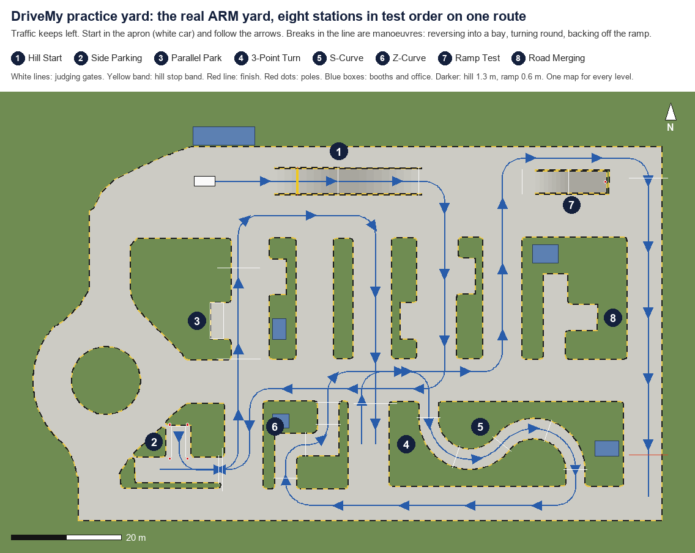
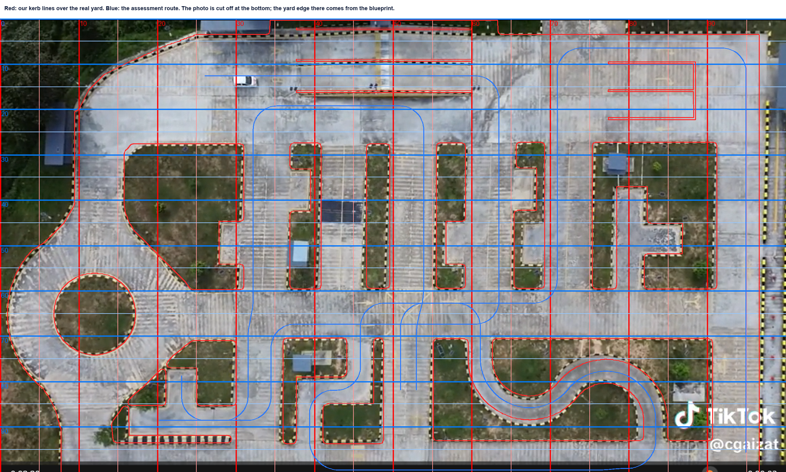
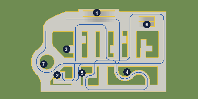

# DriveMy practice yard

The map is the real ARM Driving Institute yard in Kota Kinabalu, traced off the drone photo at
its measured scale and drawn cleanly. Every practice level uses this one map; only the place the
car starts changes. The assessment is one route through the seven stations in test order. Other cars
drive the yard's two-way roads while you do it (`traffic_gen.py`).



How the trace sits on the real yard (red: our kerb lines; blue: the route):



The in-game map, at 400 × 200 px: 

This replaces two earlier attempts. v1 traced the yard by hand and got it wrong: its layout
overlapped the real one by only 19%, and its S lane was 2.6 m against a real 3.6 m. The first v2
draft rearranged the real stations into a loop, which no longer looked like the yard. The
loop draft is kept in `archive-loop/`.

## The route

The owner's layout (20 Oct). Start in the apron at the top left, facing east, and keep left. Then:

1. **Hill:** east over the strip along the top of the yard.
2. **3-Side Parking:** down lane D-E, along the spine road and down lane G-8 to the bottom left, west
   into the band past the pocket, reverse in, then drive out east.
3. **Parallel park:** north up lane A-B; the recess is on your left.
4. **S-curve:** east along the top road, down lane C-D, east along the spine road, then south through
   the S. The three-point turn's old lane is an ordinary road now.
5. **Z-curve:** west along the bottom road, then north through the Z.
6. **Ramp:** east along the spine road, north up lane E-F; the ramp is on your right. Drive in, stop,
   reverse out, carry on north.
7. **Road merging:** east along the top lane, down the east road and west along the spine road to the
   roundabout. Give way at its entry to the cars going round, join them, leave by the north arm, and
   cross the finish at 15 km/h or faster.

The route is 678 m and crosses itself only on the spine road and at the mouth of the side-parking
band, as a real yard does. It breaks once, where the car reverses into the side bay
(`route.manoeuvres`).

| # | Station | Route s (m) | As built | Basis |
|---|---|---|---|---|
| 1 | Hill Start | 10–41 | Strip 25.75 × 4.5 m with kerbed walls: up 10.8 m, flat 4.15 m, down 10.8 m. Rise 1.3 m (12%). Yellow stop band 0.6 m long at a third of the rise. A twin strip beside it holds another learner. | Photo (strip 26.6 × 4.6 m); PRD lengths; rise and band decided |
| 2 | 3-Side Parking | 131–162 | Pocket 4.72 × 5.78 m off a 4.58 m band. Painted bay 2.6 × 5.6 m, four poles 0.3 m outside its corners. A second bay, in island F's notch, holds another learner. | Photo (pocket and band); bay and poles decided |
| 3 | Parallel Park | 184–201 | Recess 6.6 × 3.77 m on the lane's west side, with a painted box 6.6 × 2.5 m against its kerb. Heading limit 10.2°, mirrors included. | Photo (recess); box decided |
| 4 | S-Curve | 275–319 | Lane 3.6 m. Two opposite 141° bends at a 7.5 m centreline radius, 3 m straights at each end. | Photo (real S) |
| 5 | Z-Curve | 369–396 | Lane 4.0 m, driven north. Jog 7.73 m between the legs. Square outer corners, inner corners rounded 1 m. | Photo (real Z) |
| 6 | Ramp Test | 453–464 | 4.0 m wide on the open floor at the top right, in line with the hill: a 3 m run-in, 6 m up to a 0.6 m platform (10%), a 7 m platform to an end wall. The pole stands on the centreline 0.4 m before the wall. A twin ramp beside it holds another learner. | The real yard has no ramp; the blueprint draws a structure here. Dimensions decided |
| 7 | Road Merging | 616–672 | The roundabout: traffic goes round clockwise on a circle 9 m from its middle. The give-way line crosses the approach lane 3.7 m before the circle. The finish is on the north arm, 56 m from the lane's start. | PRD; the owner, 20 Oct (at the roundabout); JKR (give-way line 1.2 to 10 m); a 3 s gap decided |

Exact `s` values are in `circuit.json`.

**Practice start points.** Each station carries `start` (`at`, `heading_deg`): a spot on the route
8 m before the station. Choosing a practice level puts the car there. The map is loaded once.

**The other cars** (`traffic_gen.py` writes them; `src/sim/traffic` drives them): five cars on
keep-left loops, one round each of islands C and D each way, one round the outer roads and two round
the roundabout, at 20 to 30 km/h. J1, the spine road at lane D-E, has signals: east-west 12 s green,
north-south 10 s, 3 s amber, 1 s all-red. Each approach has two heads on the left: one 1 m past the stop line, for the queue, and one across
the junction, which the first car at the line and the second behind it see through the windscreen. The markings follow JKR's Arahan Teknik (Jalan) 2D/85, each
value cited by clause or figure.

## What the checks prove

`python check.py` reads only `circuit.json`, the car config and `../v2-plan/rules.json`, and exits
0 only if every check passes. The latest run is 39 of 39 (`check_report.json`).

- **Organised.**
  - The seven stations come in order along one route.
  - The route crosses itself only inside the declared junctions.
  - No two stations overlap, and the route enters each only on its own turn.
  - Every station and lane stays visible on the 400 × 200 px map.
- **Real.** Measured on the built yard: the S lane 3.51 m kerb to kerb (real 3.35–3.76 m), the S bends
  141° at 7.5 m as the real ones, the Z lane 4.00 m on its straight legs (real 3.9–4.0 m) and its jog
  7.73 m (real 7.7 m). The hill, the recess and the pocket match their real sizes.
- **Roomy.** A pure-pursuit driver steers the Swift through every driven piece of the route.
  - Tyres stay at least 0.35 m from every kerb inside a station, and 0.50 m on the roads between.
  - The Swift's body overhangs a Z kerb by 5 cm at one corner; overhang is not a fault.
  - Every tyre stays at least 0.42 m off every centre line (0.30 m needed); touching one fails the test.
- **Possible.**
  - **Side bay:** one full-lock reverse arc, mirrors inside the lines, all four poles untouched.
  - **Parallel box:** one two-arc reverse, mirrors inside.
  - **Hill:** the whole stop band sits on the up-slope.
  - **Ramp:** in and up with the tyres 0.86 m from the kerbs; it stops 0.81 m short of the pole,
    inside the 0.2–1.0 m window; then it reverses straight back 11.5 m and turns out on full lock,
    facing on.
  - **Merge:** 56 m of lane to reach 15 km/h, where 5.8 m would do.
  - **Practice:** every station's start point is on the road, clear of the kerbs.
  - **Signals:** from the driver's eye of the first car at each stop line and of the second behind it, a
    head shows all three lamps through the windscreen, below the roof's edge, clear of the interior
    mirror and, for the second, over the car ahead's roof.
- **Cheap.** Flat ground plus four slopes (the hill and the ramp, each with its twin); 19 kerb rings,
  968 vertices; a 172 KB data file; four booths, one office and five poles.

## Files

| File | What it is |
|---|---|
| `circuit.json` | The single source of truth the game loads (format below) |
| `generate.py` | Writes `circuit.json` from the traced outlines and the parameter table at its top. Change numbers there, never in `circuit.json` |
| `traffic_gen.py` | Called by `generate.py`: the other cars' loops, the junctions, the signal, the merge, where queues wait, and the road markings |
| `YARD-TRACE.md` | The pixel outlines read off the drone photo, and how |
| `check.py` | The checks above. `--car other.json` re-runs them for another car |
| `render.py` | Writes `circuit-plan.png` and `.svg`, `circuit-minimap.png` and `yard-vs-photo.png` |
| `lib_geom.py` | The car model (bicycle kinematics), the raster clearance field and the manoeuvre planners |
| `car-swift-2022.json` | The PRD's Swift dimensions, plus two stated assumptions |
| `AUDIT.md` | The yardstick, the verdicts, and why the map changed |
| `archive-loop/` | The loop draft this replaced |
| `PROMPT.md`, `prd-excerpt.md` | The original builder brief and its PRD snapshot |

Regenerate after any change:

```bash
python docs/circuit-v2/generate.py && python docs/circuit-v2/check.py && python docs/circuit-v2/render.py
```

## circuit.json format

- **Frame.** Metres, with x east, y north and z up. Photo pixel (px, py) is at
  x = px × 0.0943, y = (750 − py) × 0.0943. In three.js, use `X = x, Y = z, Z = -y`; car yaw equals
  the heading.
- **`site.bounds`** is `[x0, y0, x1, y1]`. The ground is grass everywhere except the pavement.
- **`pavement`** and **`kerbs.rings`** are the same rings, read even-odd: ring 0 is the yard's edge,
  and every other ring is a hole (an island, or a thin wall along the hill and the ramp). Build
  the pavement mesh from them with holes.
- **`kerbs`** gives `height` 0.13 and `width` 0.20. The kerb sits on the grass side of each ring.
- **`slopes`**: the `hill` (heading east along the strip) and the `ramp` (heading east from its foot),
  each with a twin. Each has `start`, `heading_deg`, `width` and a `profile` of `[along, z]` points,
  with solid side walls and kerbs on the deck edges.
- **`stations`** are in `order` 1–7, each with `s_from`, `s_to`, `gates` and a practice `start`.
  Per station:
  - **hill-start:** `slope`, `stop_line_height`, `stop_band`.
  - **side-parking:** the `pocket` and the painted `bay` (`centre`, `axis_deg` from the back to the
    mouth, `length`, `width`).
  - **parallel-parking:** the recess as `pocket` and the painted box as `bay`.
  - **s-curve** and **z-curve:** gates; the Z also has `legs` and `fillets`.
  - **ramp-test:** the `box`, the `pole`, and the `axis` (the slope's foot and heading), with gates
    `mouth` and `platform`.
  - **road-merging:** gates `lane-start`, `give-way` and `finish`.
- **`junctions`**: the polygons where the route may cross itself.
- **`route.samples`** has columns `[s, x, y, heading_deg, width, tag]`, one row every 0.25 m.
  **`route.manoeuvres`** lists the place the line jumps (the side-bay reverse), with `s_from`, `s_to`
  and a note. Track progress along the route by the nearest sample ahead of the last one, so the jump
  and the crossings never confuse it.
- **`markings`**: centre lines (dash and gap 0: unbroken), edge, stop and give-way lines, arrows,
  chevrons, the zebra, yellow boxes, and the bays painted off the route.
- **`traffic`**: the other cars' `loops`, the `junctions` they take one at a time, the `signals`, the
  `merge` (the give-way line and the 3 s gap), where each station's queue is `waiting`, the `zebra`, and
  the `parameters` with their sources.
- **`obstacles.poles`** gives `station`, `at`, `radius`, `height`, an optional `base_z` (the ramp
  pole stands on the 0.6 m platform), and `status`.
- **`props`** holds the booths and the office as boxes, the fence, and `npc_cars`: the other learners,
  parked mid-test on the twin hill, the twin ramp and the second 3-side bay.
- **`spawn`** gives `at`, `heading_deg` and `handbrake`.
- **`parameters`** lists every number with its `source` (photo, PRD, car, design or decided) and a
  note.

## Decided (no instructor available)

Each of these has its reasons in `../v2-plan/RULES.md`.

**14 Oct:**

- The map is the real yard, not a rearrangement of its stations.
- The hill rise stays at 1.3 m (12%).
- The ramp stands on the open floor at the top right, where the blueprint draws a structure; its
  dimensions are decided.
- The side bay is painted 2.6 × 5.6 m with four corner poles; the parallel box is painted
  6.6 × 2.5 m inside the real recess.
- Mirrors count in both bays. Body overhang over a kerb is not a fault.

**20 Oct (the owner's layout):**

- Seven stations: the three-point turn is gone, and its lane beside the Z is an ordinary road.
- Road merging is at the roundabout, joining the cars going round.
- The two-way roads have other cars, keep left, and have unbroken centre lines; touching one fails
  the test.
- The hill and the ramp each have a twin, and there is a second 3-side bay, each holding another
  learner.
- Every marking follows JKR's Arahan Teknik (Jalan) 2D/85.

Two figures remain assumptions, stated in the car config: the tyre width (185 mm) and equal
front and rear overhangs.
